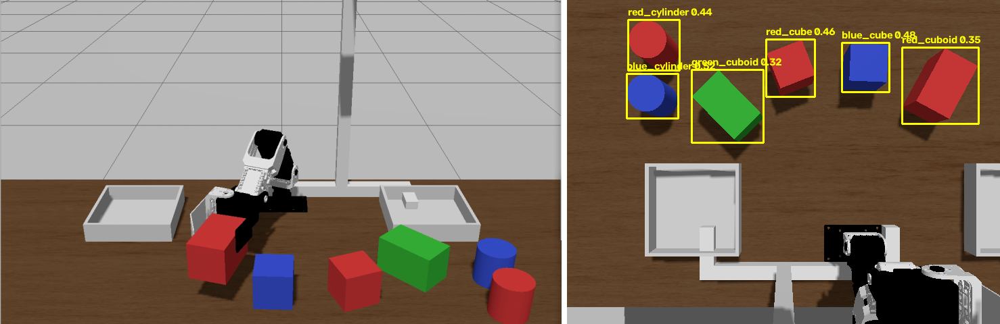
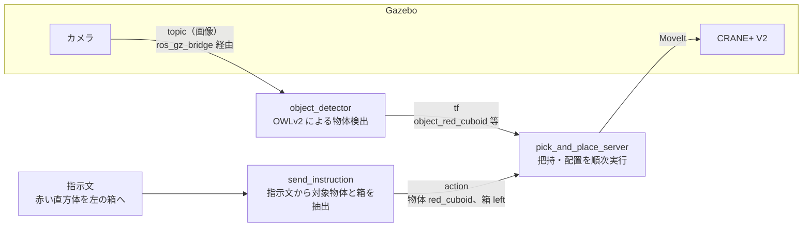

# テキスト指示に基づく同色異形物体の識別・仕分けロボットアーム

Physical AI 応用1講座（2026 年度）最終課題の成果物です。
「赤い直方体を左の箱へ」のような日本語の指示文を受け付け、Gazebo 上の小型ロボットアーム CRANE+ V2 が、机上の物体 4 個から指定の 1 個を識別・把持し、指定の箱へ投入します。
物体には、色が同一で形状のみ異なる物体（赤い立方体と赤い直方体）を含みます。

[](https://youtu.be/LNO8KtAbae4)

画像をクリックすると、YouTube でデモ動画（1.5 倍速、https://youtu.be/LNO8KtAbae4 ）を再生します。
左は赤い直方体を搬送する様子、右は物体検出の結果です。
課題の背景、工夫点、評価の詳細は、最終課題レポート [docs/report/261031_final_report.md](docs/report/261031_final_report.md) に記載しています。

## 目次

- [1. 概要](#1-概要)
- [2. システム構成](#2-システム構成)
- [3. 環境構築](#3-環境構築)
- [4. 実行方法](#4-実行方法)
- [5. 使用技術および出典](#5-使用技術および出典)
- [6. ファイル構成](#6-ファイル構成)

## 1. 概要

### 1.1 タスク

倉庫での仕分けや家庭での片付けでは、色が同一で形状のみ異なる物体が多数存在します。
出発点とした crane_plus（CRANE+ V2 のメーカー公式パッケージ）のサンプルは色範囲で物体を検出するため、これらを識別できません。
本システムは、テキストで指定した物体を画像中から検出するモデル OWLv2 を用いて、形状を含む語句で物体を識別します。

| 項目 | 内容 |
|---|---|
| 入力 | 日本語の指示文（例: 「赤い直方体を左の箱へ」）。色・形状・箱の向きを 1 つずつ含む |
| 机上の物体 | 赤い立方体、赤い直方体、青い立方体、緑の直方体の 4 個。配置は起動ごとに乱数で決定 |
| 妨害物 | 把持対象外の赤色・青色の円柱 2 個（対象物体と同色かつ異形状） |
| 動作 | 指定の物体を真上から把持し、左右いずれかの箱の上方まで搬送して解放する |
| 実行環境 | ROS 2 Jazzy、Gazebo、MoveIt 2、Docker（NVIDIA GPU を使用） |

### 1.2 評価結果

いずれも AI 版（2.3）による結果です。
詳細は最終課題レポートの 5 章と、設計資料 [docs/design/261027_ai_detector.md](docs/design/261027_ai_detector.md) の 5 章・7 章・10 章に記載しています。

| 評価 | 結果 |
|---|---|
| 検出モデル 3 種の比較（Gazebo のカメラ画像 20 枚、物体 80 個） | OWLv2 が 80 個すべてを正しく識別（次点は CLIP の 78 個、YOLO-World は 54 個） |
| 仕分け（比較に使用していない 11 通りの配置） | 指示した 44 個すべてを指定の箱へ投入 |
| 仕分け（把持対象外の円柱 2 個を追加した 5 通りの配置） | 指示した 20 個すべてを指定の箱へ投入 |
| 机上に存在しない物体、未登録の語を含む指示 | アームを動作させずに応答 |

### 1.3 主な工夫点

| 工夫点 | 内容 |
|---|---|
| 検出モデルの選定 | テキストで物体を指定できる公開モデル 3 種（YOLO-World、OWLv2、CLIP）を、追加学習なしで比較し、OWLv2 を採用した |
| ラベルと検出枠の一対一割当 | 「机上に同一ラベルの物体は 1 個のみ」という条件で割り当て、赤色 2 個の正答数を 40 個中 10 個から 40 個に改善した |
| ラベル付与済み物体の位置保持 | 物体ごとに最終観測位置を保持し、箱へ投入した物体や円柱へのラベルの入替わりを防止した |
| 仕分け環境の構築 | 物体・円柱・箱を乱数で配置し、特定の配置でのみ動作する仕組みとならないようにした |
| 検出部を差替え可能な構成 | 検出ノードと把持・配置ノードを tf のみで接続し、launch の引数 1 つで検出方式を切り替えられるようにした |
| 計算負荷の削減 | 半精度化と推論の頻度・時機の制限により、検出ノードの CPU 使用量を 3.1 コアから 0.4 コアに、GPU 使用率を 67% から 3% に削減した |
| 最新 AI ライブラリと ROS 2 Jazzy の共存 | NumPy 2 を要する AI ライブラリを Python 仮想環境に分離した（5.3） |

## 2. システム構成

### 2.1 ノード構成

自作のノード（ROS 2 におけるプログラムの単位）は、指示送信、物体検出、把持・配置の 3 種です。



指示 1 件の処理手順は次のとおりです。

1. `send_instruction` が、指示文から物体名（`red_cuboid`）と箱名（`left`）を抽出し、要求として送信する
2. `object_detector` が、カメラ画像から物体を継続的に検出してラベル（物体名）を付与し、各物体の位置を tf（座標系間の位置関係を配信する仕組み）の座標系 `object_<ラベル>` として配信する
3. `pick_and_place_server` が、物体と箱の位置を tf から取得し、MoveIt（アームの関節軌道を計画するライブラリ）でアームを駆動する。段階の移行ごとに、現在の段階を進捗として返す

冒頭のサムネイル右側の画像は、`object_detector` がカメラ画像に描画した検出枠とラベルです。同色の赤い立方体と赤い直方体、および円柱 2 個に、それぞれ異なるラベルが付与されています。

### 2.2 使用した ROS 2 の機能

| 機能 | 使用箇所 |
|---|---|
| topic | カメラ画像とカメラ内部パラメータを、同一時刻のものを組にして受信する。検出結果を描画した画像を配信する |
| tf | 物体と箱の位置を座標系として配信し、アーム基部から見た位置に変換して取得する |
| action（長時間の処理を、進捗を返しつつ実行し、取消も可能な通信方式） | 「物体 1 個を把持して箱に配置する」要求。定義ファイル（`src/crane_sorter_interfaces/action/PickAndPlace.action`）から自作した |
| executor とコールバックグループ | アーム駆動中も取消要求を受信できるよう、複数スレッドで処理する |
| launch | 起動ごとに乱数で物体配置を決定して Gazebo 上に生成する。物体検出ノードを 2 版から選択する |
| ros_gz_bridge | カメラ画像を Gazebo から ROS 2 へ転送する |

### 2.3 物体検出方式の 2 版

物体検出ノードには 2 版があり、起動時に launch の引数で選択します。
動作するシステムを早期に確保するため、まず色検出版で仕分けを完成させ、その後に検出部のみを AI 版へ差し替えました。

| 項目 | AI 版（`detector:=ai`） | 色検出版（`detector:=color`） |
|---|---|---|
| 検出方法 | 検出モデル OWLv2 に、物体を表す語句（例: `red long block`）を与えて検出 | 色範囲で画像を二値化して検出 |
| 識別できる物体 | 色と形状の組合せ（同色異形物体を含む） | 色のみ（物体は立方体に限る） |
| 実行方法 | 4.2 | 4.3 |
| 設計資料 | [docs/design/261027_ai_detector.md](docs/design/261027_ai_detector.md) | [docs/design/261025_sorting_design.md](docs/design/261025_sorting_design.md) |

## 3. 環境構築

ROS 2・Gazebo・ロボットのパッケージは、すべて Docker イメージに格納しています。
ホストには Docker のみを導入すれば実行できます。

### 3.1 前提条件

| 用途 | 必要な環境 |
|---|---|
| 全般 | Docker と Docker Compose |
| AI 版（4.2）の実行 | NVIDIA ドライバと nvidia-container-toolkit。PyTorch が CUDA 13 用のため、CUDA 13 に対応したドライバが必要 |

### 3.2 コンテナの起動

リポジトリの直下で次を実行します。
初回のイメージ作成には時間を要します（開発に使用した GPU マシンで約 15 分。イメージの容量は約 22 GB）。

```bash
docker compose build

# GPU なし
docker compose up -d

# GPU あり
docker compose -f compose.yaml -f compose.gpu.yaml up -d
```

リポジトリはコンテナ内の `/ws` にマウントされます。
ホスト側で編集したファイルは、コンテナ内にそのまま反映されます。

### 3.3 画面の表示

Gazebo などの画面は、ブラウザから noVNC（ブラウザ上でリモートの画面を操作する仕組み）で表示します。
パスワードは `ubuntu` です。

| Docker を実行するマシン | 接続方法 |
|---|---|
| 手元のマシン | ブラウザで `http://localhost:6080` を開く |
| 遠隔のマシン | 手元で `ssh -L 6080:localhost:6080 <遠隔のマシン>` を実行した後、ブラウザで `http://localhost:6080` を開く |

ポートは外部に公開せず、Docker を実行するマシン内からのみ接続できる設定としています。

### 3.4 コンテナ内でのコマンド実行

`bash -l` で入ると、ROS 2 と CRANE+ V2 のパッケージを使用できる状態になります。

```bash
docker compose exec -u ubuntu ros bash -l
```

この端末から起動した Gazebo などの画面は、3.3 の noVNC の画面に表示されます。

## 4. 実行方法

### 4.1 ビルド

本リポジトリのパッケージは `src/` に配置しています。
初回のみ、3.4 の方法でコンテナに入り、次を実行します。

```bash
cd /ws
colcon build --symlink-install
source install/setup.bash
```

`--symlink-install` を指定すると、Python のコードと設定ファイルの変更は、再ビルドなしで次回の起動から反映されます。
action の定義（`src/crane_sorter_interfaces/`）や `setup.py` を変更した場合は、再ビルドが必要です。
2 回目以降は、3.4 の方法で入るだけでビルド結果を使用できます。

### 4.2 指示文による仕分け（AI 版）

机上の赤い立方体、赤い直方体、青い立方体、緑の直方体を、指示文に従って左右の箱へ投入します。
机の奥には、把持対象外の赤色・青色の円柱も配置します。

3.4 の方法で端末を 3 つ開き、上から順に実行します。

```bash
# 端末 1: 物体 4 個と円柱 2 個の配置で Gazebo を起動する
ros2 launch crane_sorter sim.launch.py layout:=/ws/src/crane_sorter/config/layout_shapes.yaml

# 端末 2: AI 版の物体検出ノードと、把持・配置の action サーバを起動する
# 「検出モデル owlv2 を … 用意しました」と「依頼を待っています」の両方が表示されるまで待機する
ros2 launch crane_sorter sorter.launch.py detector:=ai

# 端末 3: 指示を送信する
ros2 run crane_sorter send_instruction "赤い直方体を左の箱へ" "赤い立方体を右の箱へ" "青い立方体を左の箱へ" "緑の直方体を右の箱へ"
```

端末 3 には、指示ごとに処理の段階と結果が表示されます。
机上に存在しない物体を指示した場合（例: 「黄色い立方体を左の箱へ」）、アームは動作せず、物体が見つからない旨を応答します。

初回の起動時は検出モデルの重み（約 0.6 GB）を取得するため、端末 2 の準備に数分を要します。
重みは Docker のボリューム `model-cache` に保存されるため、2 回目以降は取得しません。

検出結果は、次のコマンドで画像として表示できます。

```bash
ros2 run rqt_image_view rqt_image_view /object_detector/detections
```

使用する検出モデルとモデルに与える語句は、`src/crane_sorter/config/object_detector.yaml` で変更できます。
計算負荷を抑えるため、推論は半精度で毎秒 2 回までに制限し、アーム駆動中は停止しています。これらの設定も同じファイルで変更できます（設計資料の 9 章）。

指示文には、物体の色と形状、箱の向きを 1 つずつ含めます。
指示文は、固定の語彙表で物体名と箱名に変換します（`src/crane_sorter/crane_sorter/instruction.py`）。

| 区分 | 使用できる語 |
|---|---|
| 色 | 「赤」「緑」「青」「黄」（red、green、blue、yellow） |
| 形状 | 「ブロック」「キューブ」「立方体」（block、cube）、「直方体」「レンガ」（cuboid、brick） |
| 箱 | 「右」「左」（right、left） |

語彙表にない語を含む指示（例: 「赤いボールを右の箱へ」）は、送信前に棄却します。
左右はアームから見た向きです。Gazebo の初期視点はアームと対向しているため、画面上では右の箱が左側に表示されます。
指示の実行中に端末 3 で Ctrl+C を押すと、取消を要求します。取消できるのは物体の把持前のみです。

ノードを Ctrl+C 以外の方法（`kill -9` など）で停止すると、その後に起動したノード間の通信が成立しない場合があります。
その場合は、すべての端末を Ctrl+C で停止し、`fastdds shm clean` を実行してから再起動します。

### 4.3 指示文による仕分け（色検出版）

机上の赤・緑・青の立方体を、指示文に従って左右の箱へ投入します。
4.2 との相違点は、配置の設定ファイルと、物体検出ノードの選択のみです。

```bash
# 端末 1: 机・アーム・カメラ・箱・物体を Gazebo 上に生成する
# seed:=1 のように乱数シードを指定すると、同一の配置を再現できる
ros2 launch crane_sorter sim.launch.py

# 端末 2: 色検出版の物体検出ノードと、把持・配置の action サーバを起動する
# 端末 1 でアームの制御の準備が完了してから（起動から約 20 秒後）実行する
ros2 launch crane_sorter sorter.launch.py

# 端末 3: 指示を送信する。複数指定すると順次実行する
# 端末 2 に「依頼を待っています」と表示されてから実行する
ros2 run crane_sorter send_instruction "赤いブロックを右の箱へ" "青いブロックを左の箱へ"
```

端末 3 には、指示ごとに処理の段階と結果が表示されます。1 件あたり約 30 秒です。

```text
[1/2] 「赤いブロックを右の箱へ」→ 物体 red_cube を箱 right へ
[1/2]   段階: looking
[1/2]   段階: approaching
...
[1/2] 成功: 物体 red_cube を箱 right に置きました
```

検出結果は、次のコマンドで画像として表示できます。

```bash
ros2 run rqt_image_view rqt_image_view /color_detector/detections
```

### 4.4 crane_plus 既存サンプルの実行

出発点とした、CRANE+ V2 の公式パッケージのサンプルです。
カメラで机上の赤い立方体を検出し、アームで把持して、アームの右側に配置します。

3.4 の方法で端末を 2 つ開き、それぞれで次を実行します。
端末 2 は、端末 1 で Gazebo と RViz の画面が表示され、アームの制御の準備が完了してから（起動から約 20 秒後）実行します。

```bash
# 端末 1: 赤い立方体を配置したワールドを、カメラ付きで起動する
ros2 launch crane_plus_gazebo crane_plus_with_red_cube.launch.py use_camera:=true

# 端末 2: 赤色物体の検出ノードと、把持ノードを起動する
ros2 launch crane_plus_examples_py camera_example.launch.py example:='color_detection' use_sim_time:=true
```

端末 2 の実行後、アームは待機姿勢に移行し、立方体が 3 秒間静止して見えた時点で把持を開始します。
配置の完了まで約 1 分です。
RViz の右側には、カメラ画像と、赤色の領域を白で塗りつぶした画像が表示されます。

配置した立方体はカメラの視野から外れるため、アームは待機姿勢のまま停止します。
再度実行するには、両方の端末を Ctrl+C で停止してから再起動します。

## 5. 使用技術および出典

### 5.1 外部ソフトウェアと参考資料

| 名称 | 出典 |
|---|---|
| ROS 2 Jazzy と noVNC の Docker イメージ | [Tiryoh/docker-ros2-desktop-vnc](https://github.com/Tiryoh/docker-ros2-desktop-vnc) |
| CRANE+ V2 の ROS 2 パッケージ | [rt-net/crane_plus](https://github.com/rt-net/crane_plus)（jazzy ブランチ、コミット `34c4584`） |
| 参考にした講座のリポジトリ | [matsuolab/physicalai_pubsub](https://github.com/matsuolab/physicalai_pubsub) |
| AI 版の検出モデル OWLv2（採用） | [google/owlv2-base-patch16-ensemble](https://huggingface.co/google/owlv2-base-patch16-ensemble)（Apache-2.0）。[Hugging Face Transformers](https://github.com/huggingface/transformers)（Apache-2.0）で実行 |
| 比較した検出モデル YOLO-World | `yolov8x-worldv2.pt`。[Ultralytics](https://github.com/ultralytics/ultralytics)（AGPL-3.0）で実行。比較の結果不採用とし、Ultralytics は Docker イメージから除外した |
| 比較したモデル CLIP | [openai/clip-vit-large-patch14](https://huggingface.co/openai/clip-vit-large-patch14)。元のリポジトリ [openai/CLIP](https://github.com/openai/CLIP) は MIT License |
| PyTorch | [torch 2.14.1](https://pypi.org/project/torch/2.14.1/)。版は `docker/requirements-ai.txt` で固定 |

### 5.2 crane_plus からの流用コード

次のファイルは、rt-net/crane_plus（jazzy ブランチ、コミット `34c4584`）のファイルを元に改変したものです。
元のファイルは Apache License 2.0 で配布されているため、改変したファイルも Apache License 2.0 を維持し、各ファイルの冒頭に元のファイルと変更点を記載しています。
ライセンスの本文は [src/crane_sorter/LICENSE.crane_plus](src/crane_sorter/LICENSE.crane_plus) にあります。

| 本リポジトリのファイル（`src/crane_sorter/` 以下） | 元のファイル | 主な変更点 |
|---|---|---|
| `crane_sorter/arm.py` | `crane_plus_examples_py/crane_plus_examples_py/pick_and_place_tf.py` | アームとグリッパの駆動部のみを抽出してクラス化した。把持・配置の手順は自作の `pick_and_place_server.py` に移した。動作の実行を拒否された場合は 1 回再計画する |
| `crane_sorter/color_detector.py` | `crane_plus_examples_py/crane_plus_examples_py/color_detection.py` | 複数の色に対応した。位置をカメラの高さの固定値ではなく tf から算出する。画像端の領域を除外する |
| `launch/sorter.launch.py` | `crane_plus_examples_py/launch/camera_example.launch.py` | 起動するノードを自作のものに置き換えた。物体検出ノードを、色検出版と AI 版から選択できるようにした |
| `worlds/sorting_table.sdf` | `crane_plus_gazebo/worlds/table.sdf` | ArUco マーカー付きの立方体を除いた |
| `crane_sorter/world_models.py` の物体の物理特性 | `crane_plus_gazebo/models/aruco_cube_0/model.sdf` | 衝突形状・質量・摩擦の値を流用し、外観を単色とした。直方体も質量と摩擦は同一とした |

次のものは、複製せずに crane_plus のパッケージから直接使用しています。

- `crane_plus_gazebo` の `crane_plus_with_table.launch.py`（Gazebo・アーム・カメラ・MoveIt の起動）
- `crane_plus_examples_py` の `plan_and_execute` 関数と、MoveItPy の設定ファイル

上記以外のファイルは、本リポジトリで作成したものです（MIT License）。

### 5.3 ROS 2 と NumPy の版の選定理由

ROS 2 は、最新の長期サポート版である Lyrical ではなく Jazzy を使用しています。
CRANE+ V2 の ROS 2 パッケージは Jazzy までしか対応しておらず、その範囲で最新の長期サポート版が Jazzy であるためです。

ROS 2 のノードが使用する NumPy も、最新の 2 系ではなく、Jazzy の apt パッケージの 1.26 です。
Jazzy の OpenCV や cv_bridge（ROS 2 の画像メッセージと OpenCV の画像を相互変換する部品）は NumPy 1 系向けにビルドされており、NumPy 2 系では読込みの時点で失敗するためです。

AI 版のライブラリ（PyTorch、Transformers、OpenCV）は、開発時点の最新版を使用しています（`docker/requirements-ai.txt`）。
これらは NumPy 2 を要するため、システムの Python ではなく、Docker イメージ内の Python 仮想環境 `/opt/ai-venv` に導入しています。
AI 版の物体検出ノード（`object_detector`）のみを、この仮想環境の Python で実行します。
仮想環境の Python からも、ROS 2 の rclpy・メッセージ・tf は使用できます（2026-10-27 に確認）。cv_bridge は使用できないため、画像の変換は NumPy で実装しています。

## 6. ファイル構成

| 場所 | 内容 |
|---|---|
| `docker/`、`compose.yaml`、`compose.gpu.yaml` | Docker 環境（3 章）。AI 版のライブラリの版は `docker/requirements-ai.txt` で指定 |
| `src/crane_sorter_interfaces/` | 「物体 1 個を把持して箱に配置する」action の定義 |
| `src/crane_sorter/crane_sorter/` | ノードの Python コード（物体検出の 2 版、把持・配置、指示送信）と、物体配置の決定処理、検出モデルの呼出し処理 |
| `src/crane_sorter/launch/` | Gazebo の環境を生成する `sim.launch.py` と、ノードを起動する `sorter.launch.py` |
| `src/crane_sorter/config/` | 箱と物体の配置（色検出版は `layout.yaml`、AI 版は `layout_shapes.yaml`）、色範囲（`color_detector.yaml`）、AI 版の設定（`object_detector.yaml`） |
| `src/crane_sorter/worlds/` | 机のみの Gazebo ワールド |
| `src/crane_sorter/test/` | 単体テスト。`python3 -m pytest src/crane_sorter/test` で実行 |
| `tools/detector_comparison/` | 検出モデル比較用の、画像収集スクリプトと比較スクリプト |
| `tools/report/` | レポートの図の作成処理。検出結果画像を保存する `save_detections.py` と、録画と検出結果画像から図を作成する `make_figures.sh`。使用方法は各ファイルの冒頭に記載 |
| `experiments/` | 試験に用いた処理のうち、`src/` に含めないもの。`cylinder_distractors/` は円柱を配置した試験で、内容は同ディレクトリの README に記載 |
| `tools/video/` | デモ動画の録画スクリプト `record_demo.sh` と、字幕を付与して 1 本に編集する `edit_video.py`。画面に表示する文字列と再生速度は `video_text.yaml` で指定。使用方法は各ファイルの冒頭に記載 |
| `docs/report/` | 最終課題レポート（`261031_final_report.md`）と図 |
| `docs/design/` | 設計資料（色検出版の仕分け、AI 版の物体検出） |
| `docs/plans/` | 作業計画 |
| `docs/images/` | README 用の画像（デモ動画のサムネイル） |
