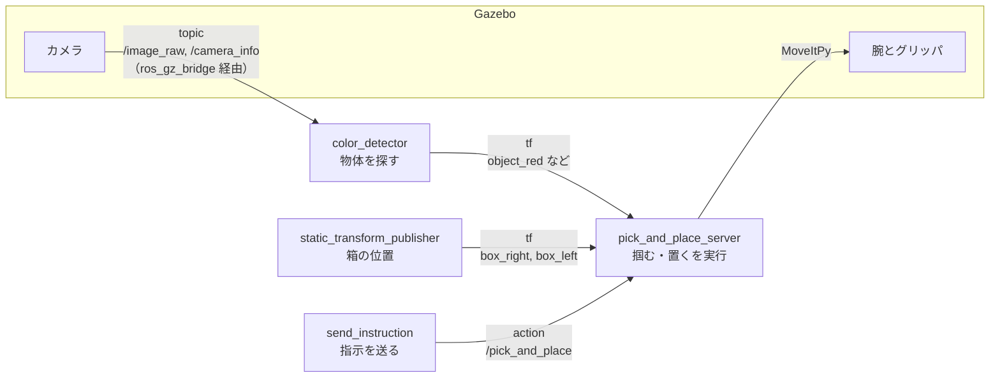
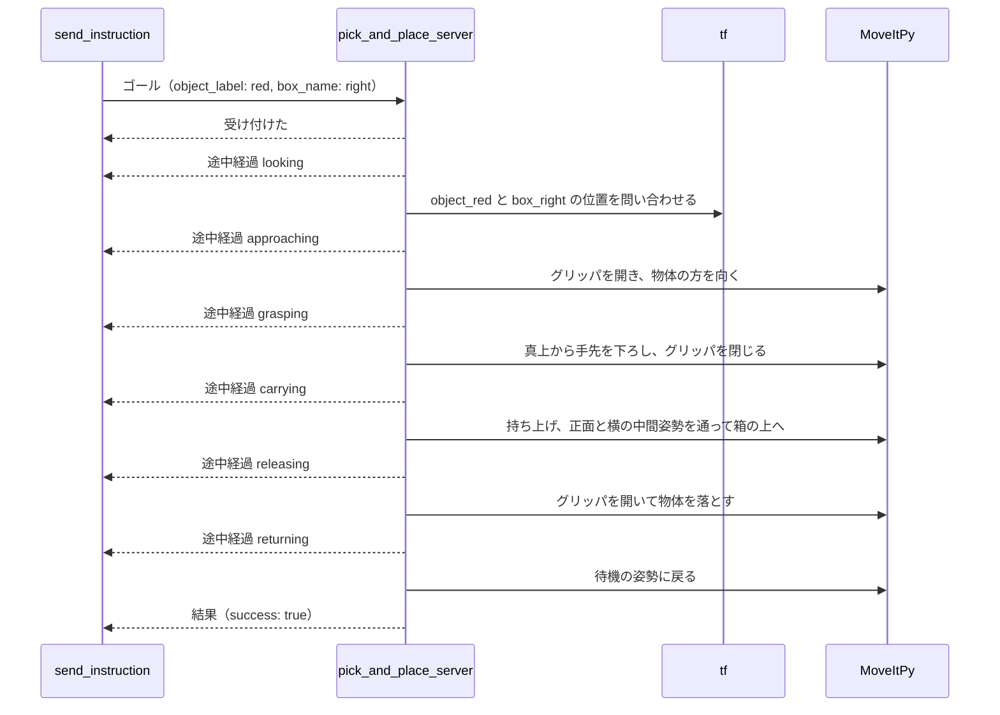

# 仕分けのノードと action の設計（案 B、2026-10-25）

計画書 4 章の 10/27〜28 の作業で作った、文の指示で物体を箱に仕分ける仕組み（案 B）の説明です。
これを読めば、どのノードが何をしてどうつながるか、自作した action の中身、ROS 2 の各仕組みをどこで使っているかが分かります。
提出者に確かめてほしい点は、最後の 8 章にまとめました。
動かし方は [README](../../README.md) の 2 章にあります。

## 目次

- [1. 全体の流れ](#1-全体の流れ)
- [2. ノードとつながり](#2-ノードとつながり)
- [3. action の定義](#3-action-の定義)
  - [3.1 action を選んだ理由](#31-action-を選んだ理由)
  - [3.2 定義ファイル](#32-定義ファイル)
  - [3.3 依頼の受け方](#33-依頼の受け方)
  - [3.4 1 件の依頼の流れ](#34-1-件の依頼の流れ)
- [4. 環境](#4-環境)
- [5. 物体の位置の求め方](#5-物体の位置の求め方)
- [6. ROS 2 の仕組みの使いどころ](#6-ros-2-の仕組みの使いどころ)
- [7. 動作確認の結果](#7-動作確認の結果)
  - [7.1 配置を変えての成功率](#71-配置を変えての成功率)
  - [7.2 失敗する場合の扱い](#72-失敗する場合の扱い)
  - [7.3 見つかった問題と直し方](#73-見つかった問題と直し方)
- [8. 提出者に確かめてほしいこと](#8-提出者に確かめてほしいこと)

## 1. 全体の流れ

「赤いブロックを右の箱へ」と指示してから、物体が箱に入るまでは次のように進みます。

1. 指示を送るコマンド（`send_instruction`）が、文から物体の名前 `red` と箱の名前 `right` を取り出し、依頼として送る
2. 掴む・置くを実行するノード（`pick_and_place_server`）が依頼を受け、物体と箱の位置を tf から読む
3. MoveIt で腕を動かし、物体を真上から掴み、箱の上まで運んで離す
4. 段階が進むたびに途中経過を、終わったら結果を、指示を送ったコマンドに返す

物体の位置は、物体を探すノード（`color_detector`）がカメラ画像から探し、tf で配信し続けています。
文の解釈は、決まった言葉（赤・緑・青、右・左）を探すだけの簡単なものです。

## 2. ノードとつながり

自作のノードは 3 つです。物体を探すノードと掴む・置くノードは、tf だけでつながっています。
そのため、10/29 に物体を探す方法を AI に替えるときも、同じ名前の tf を配信すれば、掴む・置く側は書き換えずに済みます。



| ノード | 起動のしかた | 役割 |
|---|---|---|
| `color_detector` | `sorter.launch.py` | カメラ画像から色で物体を探し、位置を tf の座標系 `object_<色>` として配信する。検出結果を描いた画像も配信する |
| `pick_and_place_server` | `sorter.launch.py` | action の依頼を受け、掴む・置くを順に実行する |
| `send_instruction` | コマンドとして実行 | 文の指示を依頼にして順に送り、途中経過と結果を表示する |
| `static_transform_publisher`（2 個） | `sim.launch.py` | 箱の位置を tf の座標系 `box_<名前>` として配信する。ROS 2 に元からあるノード |

tf の座標系は、ある座標系から見た別の座標系の位置と向きを、名前で引けるようにした仕組みです。
たとえば `object_red` は「赤い物体の位置に置いた座標系」で、`pick_and_place_server` は「腕の根元（`crane_plus_base`）から見た `object_red` の位置」を tf に問い合わせます。

## 3. action の定義

### 3.1 action を選んだ理由

「1 個掴んで箱に置く」は、1 件に 20 秒ほどかかります。
依頼主は、結果だけでなく、今どの段階にいるかも知りたく、必要なら途中でやめさせたいはずです。
ROS 2 の通信の種類のうち、これを全部できるのは action だけです。

| 通信の種類 | 結果を返せる | 途中経過を返せる | 途中で取り消せる |
|---|---|---|---|
| topic（一方向に流し続ける） | × | × | × |
| service（1 回の問いと答え） | ○ | × | × |
| action（時間のかかる依頼） | ○ | ○ | ○ |

### 3.2 定義ファイル

定義は [PickAndPlace.action](../../src/crane_sorter_interfaces/action/PickAndPlace.action) にあります。
`---` で区切った 3 つの部分が、それぞれゴール（依頼の内容）、結果、途中経過のメッセージになります。

```text
# ゴール（依頼の内容）
string object_label  # 掴む物体の名前。例: "blue"
string box_name      # 置く箱の名前。例: "right"
---
# 結果
bool success
string message                       # 何が起きたかの説明。失敗したときはその理由
geometry_msgs/Point object_position  # 掴みに行った物体の位置。crane_plus_base から見た値 [m]
---
# 途中経過
string stage  # いまの段階。looking / approaching / grasping / carrying / releasing / returning
```

ゴールに位置ではなく名前を入れたのは、物体の位置を知っているのが物体を探すノードの側だからです。
依頼主は「何を、どこへ」だけを伝え、位置は掴む・置くノードが tf から読みます。

このファイルは、ビルドすると Python や C++ のクラス（`crane_sorter_interfaces.action.PickAndPlace`）になります。
action の定義は C++ のビルドの仕組み（`rosidl`）でしか作れないため、Python のノードとは別のパッケージ `crane_sorter_interfaces` に分けています。

### 3.3 依頼の受け方

腕は 1 本なので、同時に実行する依頼は 1 件だけにしています。
状況ごとの扱いは次のとおりです。

| 状況 | サーバの扱い | 依頼主に返る結果の例 |
|---|---|---|
| 別の依頼を実行中 | 受け付けない | 断られました（ほかの依頼を実行中です） |
| 物体の tf がない、または腕の関節の tf より 1 秒以上古い | 腕を動かさずに中止 | 物体 red が見つかりません |
| 箱の tf がない | 腕を動かさずに中止 | 箱 center が見つかりません |
| 物体が指示の箱にもう入っている | 腕を動かさずに成功 | 物体 blue はすでに箱 left の中にあります |
| 物体が別の箱に入っている | 腕を動かさずに中止。箱の壁が邪魔で掴めないため | 物体 blue は箱 left の中にあり、取り出せません |
| 掴み損ねた（指が閉じきった） | 待機の姿勢に戻って中止 | 物体を掴めませんでした |
| 掴む前に取り消しを求められた | 待機の姿勢に戻って取り消し | 取り消しました |
| 掴んだあとに取り消しを求められた | 物体を途中で落とさないよう、箱に置き終えてから成功 | 物体 red を箱 right に置きました |

掴み損ねは、閉じたあとのグリッパの角度で判断しています。
5 cm のキューブを掴むと約 6 度で止まり、何もないと 10 度まで閉じるので、8 度以上なら掴み損ねとみなします。

物体が今も見えているかは、tf に付いた時刻で判断しています。
物体を探すノードは、物体が写っている間だけ tf を配信し続けるので、見えなくなった物体の tf は古いまま残ります。
そこで、関節の状態が届くたびに更新される腕の tf（`crane_plus_link1`）の時刻と比べ、物体の tf がそれより 1 秒以上古ければ、見えていないとみなします。

### 3.4 1 件の依頼の流れ

途中経過の段階（`stage`）と、腕の動きの対応は次のとおりです。



取り消しの求めはいつでも受け付けますが、実際にやめるのは approaching と grasping に入る直前の 2 か所です。
腕を動かしている途中では止めず、その動作が終わってからやめます。

## 4. 環境

起動のたびに物体の位置を変え、決まった配置でしか動かない仕組みにならないようにしています。
配置の数値は [layout.yaml](../../src/crane_sorter/config/layout.yaml) の 1 か所だけに書き、Gazebo への配置と箱の tf の配信の両方がそこから読みます。

| もの | 置き方 | そうした理由 |
|---|---|---|
| 机・腕・カメラ | crane_plus の launch をそのまま使う。机のワールドからは、元からあった ArUco マーカー付きのキューブを除いた | キューブの側面が赤く、赤い物体として誤検出されるため |
| 箱 2 個 | 腕の右 (0.04, −0.23) と左 (0.04, 0.23)。外寸 13 cm、壁の高さ 3 cm の灰色の箱 | 腕が箱の上 10 cm まで手先を届かせられる位置。x = 0 だと左の箱がカメラ台の脚と重なる。壁が低いのは、物体を上から落として入れるため |
| 物体 3 個 | 赤・緑・青の 5 cm のキューブ。根元から 0.20〜0.26 m、向き −30〜45 度の扇形の中から、互いに 10 cm 以上離して選ぶ | 腕が真上から掴める範囲と、カメラの視野の両方に収まる範囲。物理特性は既存例で掴めた赤いキューブと同じにし、色だけを変えた |

座標は腕の根元から見た値（単位 m）で、x は腕の正面、y は腕から見て左が正です。
「右の箱」「左の箱」も腕から見た左右です。Gazebo の初期の視点は腕と向かい合っているので、画面では右の箱が左側に見えます。

物体の向きは、腕の根元の方を向くようにそろえています。
CRANE+ V2 は手首をひねれないので、真上から掴むときのグリッパの向きが、根元から物体への方向で決まるためです。

## 5. 物体の位置の求め方

元にした crane_plus の例は、カメラから物体までの距離を 0.46 m と決め打ちして位置を求めていました。
この仕組みでは、tf でカメラの位置と向きを読み、計算で求めます。

1. 画像を HSV（色相・彩度・明度）に変え、色ごとに決めた範囲に入る画素を拾う
2. 拾った画素のかたまりのうち、最も大きいものの重心を求める。画像の端に接したかたまりは、物体の一部しか写っておらず重心がずれるので捨てる
3. カメラから重心の画素の方向に伸ばした視線と、腕の根元から見て高さ 0.035 m の平面との交点を、物体の位置とする
4. その位置を、カメラの座標系から見た tf の座標系 `object_<色>` として配信する

平面の高さを、キューブの上面（0.05 m）より低くしているのは、カメラから見ると上面だけでなく側面も写り、重心が上面の中心より低い点に当たるためです。
0.05 m にしたときは位置が最大 9 mm ずれ、0.035 m にすると 3 mm 以内に収まりました（Gazebo 上の正しい位置との比較）。

## 6. ROS 2 の仕組みの使いどころ

計画書 2.3 で挙げた仕組みを、次の場所で使っています。

| 仕組み | 使っている場所 | していること |
|---|---|---|
| topic | `color_detector` | `/image_raw` と `/camera_info` を、同じ時刻のものを組にして受け取る（`message_filters`）。検出結果の画像を `/color_detector/detections` に流す |
| tf | `color_detector`、`static_transform_publisher`、`pick_and_place_server` | 物体と箱の位置を座標系として配信し、腕の根元から見た位置に変換して読む。カメラから見た位置を根元から見た位置に直す計算は、tf が受け持つ |
| action | `PickAndPlace.action`、`pick_and_place_server`、`send_instruction` | 定義ファイルを自分で書き、サーバとクライアントを実装した。受け付けの判断、途中経過、取り消しを使う |
| launch | `sim.launch.py`、`sorter.launch.py` | crane_plus の launch を取り込み、起動時に乱数で物体の位置を決めて Gazebo に置く（`OpaqueFunction`） |
| ros_gz_bridge | crane_plus の launch の中 | カメラ画像を Gazebo から ROS 2 に流す。設定は crane_plus のものをそのまま使う |
| parameter | `color_detector.yaml`、各ノードの `declare_parameter` | 色の範囲や判定のしきい値を、コードを変えずに調整できるようにした |
| executor とコールバックグループ | `pick_and_place_server` | 腕を動かしている間も取り消しの求めを受け取れるよう、action のコールバックを、複数のスレッドで並行して呼べるグループに入れる。tf は専用のノードと専用のスレッドで受け取る |
| 時刻（use_sim_time） | `pick_and_place_server`、`color_detector` | 自作の Python のノードは Gazebo の時計を使わず、メッセージに付いた時刻どうしを比べる。理由は 7.3 |

## 7. 動作確認の結果

2026-10-25 に GPU マシンで確かめました。
物体が箱に入ったかは、Gazebo 上の物体の正しい位置で判断しています（箱の中心から縦横 6 cm 以内、高さ 12 cm 未満）。

### 7.1 配置を変えての成功率

物体の配置の乱数の種を 1〜10 に変え、毎回シミュレーションから起動し直して、次の 3 つの指示を順に送りました。

```bash
ros2 run crane_sorter send_instruction "赤いブロックを右の箱へ" "青いブロックを左の箱へ" "緑のブロックを右の箱へ"
```

| 項目 | 結果 |
|---|---|
| 指示どおりの箱に入った物体 | 30 個中 30 個（10 回とも 3 個すべて） |
| 指示 3 件にかかった時間 | 平均 90 秒（87〜93 秒） |
| 箱の中心からのずれ | 最大 1.8 cm（箱の内側の半分の幅は 6 cm） |
| 掴んだときのグリッパの角度 | 5.5〜6.6 度（掴み損ねとみなすのは 8 度以上） |
| 依頼を受けた時点での、物体の位置の古さ | 最大 0.19 秒（見えていないとみなすのは 1 秒以上） |

右の箱には 2 個入れるので、2 個目は 1 個目の上に重なりました。
左の箱の物体は、壁に寄りかかって少し傾いて止まることが多くありました。

### 7.2 失敗する場合の扱い

3.3 の表のとおりに扱われることを、次の操作で確かめました。

| 操作 | 結果 |
|---|---|
| 右の箱に入れた赤い物体（カメラの視野の外）を、左の箱へと指示した | 腕を動かさずに「物体 red が見つかりません」 |
| 左の箱に入れた青い物体を、左の箱へと指示した | 腕を動かさずに「すでに箱 left の中にあります」で成功 |
| 左の箱に入れた青い物体を、右の箱へと指示した | 腕を動かさずに「箱 left の中にあり、取り出せません」 |
| 存在しない箱 center を指示した | 腕を動かさずに中止 |
| 色のない指示「ブロックを右の箱へ」を送った | 送る前にクライアントが断った |
| 依頼の実行中に、別の依頼を送った | 2 件目は断られた |
| 物体の方を向いている途中で Ctrl+C を押した | 掴む前に止まり、待機の姿勢に戻って「取り消しました」。残りの指示は送られなかった |

### 7.3 見つかった問題と直し方

作る途中で見つかった問題と、その直し方です。

| 問題 | 原因 | 直し方 |
|---|---|---|
| 赤い物体の位置に、別の赤い物体が混ざって見つかる | crane_plus の机のワールドに、側面が赤い ArUco マーカー付きのキューブが元から置かれていた | このキューブを除いたワールドを作った（4 章） |
| 物体の位置が最大 9 mm ずれる | キューブの側面も写り、かたまりの重心が上面の中心より低い点に当たる | 視線と交わらせる平面を 0.035 m に下げた（5 章） |
| 箱に入れた物体を掴みに行き、掴み損ねる | 画像の端に一部だけ写った物体を検出し、ずれた位置に手先を下ろした | 端に接したかたまりを捨て、箱の中の物体は取り出さないことにした |
| 起動の直後の依頼が「見えていません」で失敗する（5 回に 1 回） | サーバが腕を初期の姿勢に動かしている間、tf の受信が止まって溜まった。その後も、毎秒 1000 回届く Gazebo の時計と同じ executor で処理していたため、追いつくまでに数秒かかった | tf を専用のノードと専用のスレッドで受け取るようにした。また、自作の Python のノードは Gazebo の時計を使わないようにし、待機中のサーバの CPU 使用率が 116% から 30% に下がった |
| Ctrl+C を押しても、取り消しが 3 秒ほど遅れて届き、間に合わない | クライアントが、次のメッセージが届くまで C の関数の中で待ち続け、その間は Ctrl+C を受け取れなかった | 0.1 秒ごとに待ちを区切るようにした |
| 強制終了したあと、ノードどうしの通信が通らなくなる | ROS 2 の通信（DDS）が使う共有メモリが、強制終了したプロセスの分だけ残った | 端末では Ctrl+C で止める。残ったときは `fastdds shm clean` で消す |

## 8. 提出者に確かめてほしいこと

次の点は Claude が決めました。直したい点があれば伝えてください。

| 項目 | 今の決め方 | ほかの案 |
|---|---|---|
| action の名前と項目 | `PickAndPlace`。ゴールは物体の名前と箱の名前 | ゴールに指示の文をそのまま入れ、サーバの中で解釈する。10/29 に AI で文を解釈するなら、この形の方が自然になる |
| 取り消しを受け付ける時点 | 物体を掴む前だけ | どの段階でも受け付け、掴んだあとならその場で物体を離す |
| 箱の中の物体 | 取り出さない | 箱の中からも掴みに行く。壁に指が当たるので、掴む位置の工夫が要る |
| 左右の決め方 | 腕から見た左右 | 動画を撮るときの視点から見た左右に合わせる |
| 物体の種類 | 色だけが違う 5 cm のキューブ 3 個 | 形の違う物体を足す。計画書 6 章のとおり、形を変えるのは最後に回す |
