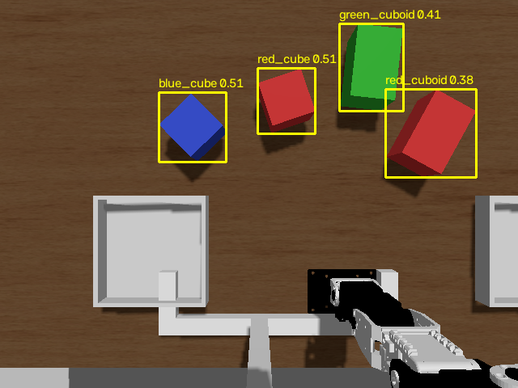

# AI 版の物体検出と、形の違う物体（案 A、2026-10-27）

計画書 4 章の 10/29 の作業の結果です（issue #4）。
物体を探すノードを、色の範囲で探す版（案 B、[仕組みの説明](261025_sorting_design.md)）から、文で指定した物体を画像から探す検出モデルの版（案 A）に入れ替えました。
あわせて、提出者の判断（2026-10-27）どおり、形の違う物体を足しました。

提出者に判断してほしいことは、最後の 8 章にまとめました。
動かし方は [README](../../README.md) の 2.3 にあります。

## 目次

- [1. 結論](#1-結論)
- [2. 案 B からの変化](#2-案-b-からの変化)
- [3. 形の違う物体](#3-形の違う物体)
- [4. 検出モデルの比べ方](#4-検出モデルの比べ方)
  - [4.1 比べたモデル](#41-比べたモデル)
  - [4.2 データと判定](#42-データと判定)
  - [4.3 名前と枠の組み合わせ方](#43-名前と枠の組み合わせ方)
- [5. 比べた結果](#5-比べた結果)
- [6. AI 版の物体を探すノード](#6-ai-版の物体を探すノード)
  - [6.1 名前を覚えておく](#61-名前を覚えておく)
  - [6.2 仮想環境とモデルの重み](#62-仮想環境とモデルの重み)
- [7. 仕分けの結果](#7-仕分けの結果)
- [8. 提出者に判断してほしいこと](#8-提出者に判断してほしいこと)

## 1. 結論

- 物体は、赤いキューブ・赤い直方体・青いキューブ・緑の直方体の 4 個にした。赤い 2 個は色が同じなので、色の範囲で探す案 B では見分けられない
- 検出モデル 3 つを Gazebo のカメラ画像 20 枚で比べた。色の違う物体はほぼどのモデルも見分けたが、赤いキューブと赤い直方体の見分けに大きな差が出た
- 最も正確だったのは OWLv2 で、80 個すべてを見分けた（5 章）。仮にこれを使う設定にしてある。最終的にどれを使うかは提出者が決める（8 章）
- 見分けの正しさを大きく上げたのは、モデルの選び方よりも、名前の付け方の工夫だった。同じ名前の物体は 1 個しかないことを使い、名前と枠を 1 対 1 に組み合わせる（4.3）。さらに、仕分けの途中で名前が入れ替わらないよう、名前を付けた物体の位置を覚えておく（6.1）
- AI 版で、比べるのに使っていない 11 通りの配置で、文で指定した物体 44 個をすべて指定の箱に置けた（7 章）。計画書 4 章の 10/29 の「次へ進む条件」を満たした

## 2. 案 B からの変化

| 項目 | 案 B（10/25） | 案 A（この文書） |
|---|---|---|
| 物体を探すノード | `color_detector`（色の範囲） | `object_detector`（検出モデル）。`sorter.launch.py detector:=ai` で選ぶ。案 B のノードも残してあり、既定は案 B |
| 物体 | 赤・緑・青のキューブ 3 個（`layout.yaml`） | 赤いキューブ、赤い直方体、青いキューブ、緑の直方体の 4 個（`layout_shapes.yaml`） |
| 物体の名前 | `red`、`green`、`blue` | `red_cube`、`red_cuboid` のように「色_形」。案 B も同じ形に変えた |
| 指示の解釈 | 色と箱の言葉を探す | 色・形・箱の言葉を探す。形は「ブロック・キューブ・立方体」と「直方体・レンガ」 |
| 掴む・置くノード | `pick_and_place_server` | 同じ。物体の位置は同じ名前の tf で受け取るので、物体を探すノードを替えても書き換えていない。腕の動作の実行を断られたときに 1 回計画し直す処理だけを足した（3 章） |
| 動かす Python | システムの Python（NumPy 1.26） | AI 版のノードだけ、仮想環境の Python（NumPy 2.5） |

物体を探すノードと掴む・置くノードは、案 B と同じく tf の座標系 `object_<物体の名前>` だけでつながっています。
計画書 2.2 で決めたこのつなぎ方のおかげで、物体を探す方法を入れ替えても、掴む・置く側には手を入れずに済みました。

## 3. 形の違う物体

計画書 6 章の「形を変えるのは最後に回す」のとおり、物理特性はキューブ（掴めることが分かっているもの）と同じにして、形だけを変えて試しました。
赤い物体を 1 個だけ形を変え、案 B の仕組みで掴ませています。

| 形 | 結果 | 考えた理由 |
|---|---|---|
| 球（直径 5 cm） | 掴めない。指が触れると転がり、腕の根元まで転がっていった | 球は 1 点でしか机に触れていないので、指に押されると転がる |
| 円柱（直径 5 cm、立てて置く） | 3 回とも掴めない。指が閉じきった | 円柱は指に押されて 1.3 cm ずれ、そのまま指の間から抜けた。手の衝突形状を調べると、固定側の指は 2 本に分かれているように見え、その間に丸い面が入り込むのではないかと考えている（確かめてはいない）。真の円柱の代わりに 16 角柱の衝突形状にしても、物理演算の衝突判定の方式を変えても、掴む高さを下げても、指の中心に物体が来るように手先をずらしても、同じだった |
| 円柱（直径 6 cm） | 3 回のうち 1 回だけ箱に置けた | 1 回は指が閉じきって掴めず、1 回は運ぶ途中で落ちた |
| 直方体（5 × 5 × 8 cm、根元から離れる向きに長く置く） | 最初は 6 回のうち 4 回箱に置けた。指を下ろせた 5 回はすべて掴めた。下の対処のあとは 6 回とも置けた | キューブと同じく、平らな面を挟める |

そこで、形の違う物体は直方体にしました。
上から見ると、キューブは正方形、直方体は長方形に写ります。

直方体を運ぶと、腕が止まりきらないうちに次の動作を計画してしまい、MoveIt が実行を断ることがありました（`start point deviates from current robot state`）。
キューブでは起きませんでした。
`arm.py` で、腕の動作の実行を断られたら 0.5 秒待ち、今の姿勢から 1 回だけ計画し直すようにしました。
これで 6 回とも置けるようになりました。

## 4. 検出モデルの比べ方

### 4.1 比べたモデル

計画書 2.1 で挙げた 3 つです。どれも公開されている学習済みの重みをそのまま使い、新たな学習はしていません。

| モデル | 使った重み | 物体の探し方 | ライブラリとライセンス |
|---|---|---|---|
| YOLO-World | `yolov8x-worldv2.pt`（公開されている中で最も大きいもの） | 文で指定した物体を、画像の中から枠で探す | Ultralytics 8.4.190。AGPL-3.0 |
| OWLv2 | `google/owlv2-base-patch16-ensemble` | 同じく、文で指定した物体を枠で探す | Transformers 5.21.0。モデルもライブラリも Apache-2.0 |
| CLIP | `openai/clip-vit-large-patch14` | 物体を探す機能はない。色の鮮やかな画素のかたまりを候補として切り出し、候補ごとに各文との近さを点数にする | Transformers 5.21.0。OpenAI の CLIP のリポジトリは MIT License。Hugging Face のモデルの説明にはライセンスの記載がない |

### 4.2 データと判定

- 画像: AI 版の配置（`layout_shapes.yaml`）を、乱数の種 1〜20 で 20 通りに置き、Gazebo のカメラ画像を 1 枚ずつ撮った（`tools/detector_comparison/capture_dataset.py`）。物体は 4 個なので、見分ける対象は 80 個
- 正しい位置: 撮ったときの Gazebo の物体の位置
- 判定: モデルが付けた枠の中心から、物体を探すノードと同じ計算で位置を求める。指定した物体の正しい位置との水平の距離が 2 cm 以内なら「正しく見つけた」とする。2 cm は、掴むときに指が物体に届く余裕から決めた
- 文: 色はそのまま英語にし、形の言い方を 3 通り試した（cube / cuboid、cube / rectangular block、square block / long block）
- 速さ: GPU（Quadro RTX 6000）で、画像 1 枚の推論にかかった時間の中央値

比べるスクリプトは `tools/detector_comparison/compare_detectors.py` です。

### 4.3 名前と枠の組み合わせ方

最初は、枠ごとに最も点数の高い名前を付けていました。
すると、赤いキューブと赤い直方体の両方に同じ名前（たとえば両方とも「赤い直方体」）が付くことが多く、片方を見失いました。
モデルは「赤い」ことはよく分かる一方、「キューブか直方体か」の点数の差が小さく、どちらかに偏るためです。

そこで、同じ名前の物体は机の上に 1 個しかない、という課題の条件を使いました。
名前と枠を 1 対 1 に、点数の合計が最も大きくなるように組み合わせます（`detectors.py` の `assign_labels`）。
こうすると、2 つの枠のどちらも「直方体」の点数のほうが高くても、「キューブ」の点数が相対的に高い方の枠がキューブになります。
色の範囲で探す案 B で「色ごとに最も大きいかたまりを 1 つ選ぶ」としていたのと同じ考え方を、検出モデルの点数に当てはめたものです。

## 5. 比べた結果

OWLv2（square block / long block）が、種 2 の配置で 4 個に付けた枠と名前です。

| モデル | 形の言い方（キューブ / 直方体） | 正しく見つけた（全 80 個） | うち赤い 2 個（全 40 個） | 参考: 枠ごとに最高点の名前を付けたときの赤い 2 個 | 位置の誤差（中央値） | 1 枚の推論（中央値） |
|---|---|---|---|---|---|---|
| YOLO-World | cube / cuboid | 50 | 10 | 15 | 1 mm | 25 ms |
| YOLO-World | cube / rectangular block | 54 | 14 | 7 | 1 mm | 24 ms |
| YOLO-World | square block / long block | 33 | 6 | 4 | 2 mm | 24 ms |
| OWLv2 | cube / cuboid | 74 | 34 | 22 | 1 mm | 182 ms |
| OWLv2 | cube / rectangular block | 60 | 20 | 7 | 1 mm | 185 ms |
| **OWLv2** | **square block / long block** | **80** | **40** | 10 | 1 mm | 182 ms |
| CLIP | cube / cuboid | 61 | 21 | 14 | 5 mm | 70 ms |
| CLIP | cube / rectangular block | 78 | 38 | 29 | 5 mm | 70 ms |
| CLIP | square block / long block | 67 | 27 | 17 | 5 mm | 70 ms |

分かったことは次のとおりです。

- 色の違う 2 個（青いキューブと緑の直方体）は、YOLO-World の 1 通りを除き、どの組み合わせも 20 枚すべてで見分けた
- 差が出たのは、色が同じで形の違う赤い 2 個だった。間違えたときの位置のずれは 17〜20 cm で、もう一方の赤い物体と取り違えていた
- YOLO-World は、どの言い方でも赤い 2 個をほとんど見分けられなかった。CLIP は 1 対 1 の組み合わせで 38/40 まで上がった。OWLv2 は言い方によって 20/40〜40/40 と大きく変わった
- 1 対 1 の組み合わせは、OWLv2（square block / long block）で赤い 2 個を 10/40 から 40/40 に上げた
- 見つけたときの位置の誤差は、YOLO-World と OWLv2 で 1〜2 mm、CLIP で 5 mm だった。CLIP の枠は、色のかたまりに余白を足したものなので少しずれる。どれも掴むには十分小さい
- 速さは YOLO-World が最も速く、OWLv2 が最も遅い。ただしカメラ画像は 1 秒に 5 枚（200 ms ごと）しか届かないので、OWLv2 の 182 ms でも間に合う

注意: 形の言い方は、同じ 20 枚で結果を見て選んだので、この 20 枚に合わせ込んだ可能性があります。
そのため、7 章では、比べるのに使っていない配置（種 21〜31）で仕分けを試しました。

## 6. AI 版の物体を探すノード

`src/crane_sorter/crane_sorter/object_detector.py` です。

1. `/image_raw` と `/camera_info` を、同じ時刻のものを組にして受け取る
2. 検出モデルで、物体の候補の枠と、名前ごとの点数を求める
3. 枠の中心を通る視線と、物体の高さに合わせた平面との交点を、候補の位置とする。カメラの位置姿勢は tf から読む。計算は案 B と同じで、NumPy だけで書き直した（`camera_geometry.py`）
4. 候補に名前を付ける（6.1）
5. 位置を tf の座標系 `object_<物体の名前>` として配信する。枠と名前を描いた画像を `/object_detector/detections` に流す

設定は `src/crane_sorter/config/object_detector.yaml` にあります。
主なパラメータは次のとおりです。

| パラメータ | 値 | 意味 |
|---|---|---|
| `labels` | `red_cube` など 4 つ | 物体の名前。`layout_shapes.yaml` の label と、指示の解釈が作る名前に合わせる |
| `prompts` | `red square block` など 4 つ | それぞれの名前をモデルに渡す英語の文。物体を増やすときは、学習し直さずに、ここに名前と文を足せばよい |
| `model` | `owlv2` | `yolo_world`、`owlv2`、`clip` から選ぶ |
| `score_threshold` | 0.1 | これより点数の低い組み合わせは使わない |
| `plane_height` | 0.035 m | 視線と交わらせる平面の高さ |

### 6.1 名前を覚えておく

4.3 の 1 対 1 の組み合わせを画像ごとにやり直すだけでは、仕分けの途中で名前が入れ替わりました。
種 22 の配置で、赤い直方体を左の箱に入れたあと、「赤いキューブを右の箱へ」と指示すると、箱の中の直方体を赤いキューブとみなして「箱 left の中にあり、取り出せません」で止まりました。
直方体は箱の中で平らに置かれていましたが、箱の中では見え方が変わり、机の上のキューブよりも「キューブらしい」点数になったためです。

机の上の物体は、腕が動かさない限り動きません。
そこで、名前を付けた物体を最後に見た位置を覚えておき、次の画像でその位置から 2.5 cm 以内に候補があれば、同じ名前を付けます（`label_tracker.py`）。
覚えている位置の近くにない候補にだけ、空いている名前から 1 対 1 に組み合わせます。
名前が空くのは、その名前の物体が 2 秒より長く見えなかったときです。
腕に一瞬隠れただけの物体の名前を、腕が運んでいる別の物体に取られないよう、すぐには空けません。

こうすると、赤い 2 個が机の上に並んでいるあいだに付けた名前が、箱に入れたあとも保たれます。
運んだ物体の名前は、運び始めて 2 秒たつと空き、箱の中に現れた物体に付きます。

### 6.2 仮想環境とモデルの重み

検出モデルのライブラリ（torch 2.14.1、Transformers 5.21.0、Ultralytics 8.4.190）は、NumPy 2 を要します。
Jazzy の ROS 2 のノードは NumPy 1.26 のままにする必要があるので（README の 3.3）、ライブラリは Docker イメージの中の Python の仮想環境 `/opt/ai-venv` に入れ、AI 版のノードだけをその Python で動かします（`sorter.launch.py` の `prefix`）。
仮想環境の Python からも、ROS 2 の rclpy・メッセージ・tf はそのまま使えることを確かめました。
NumPy 1 向けにビルドされた cv_bridge と image_geometry は使えないので、画像の変換と位置の計算は NumPy で書きました。

モデルの重みは、初めて使うときに取得し、Docker のボリューム（`model-cache`）に置きます。
コンテナを作り直しても、取得し直さずに済みます。
重みの大きさは、YOLO-World が 0.14 GB（文を読む CLIP の 0.35 GB を別に使う）、OWLv2 と CLIP（ViT-L/14）が合わせて 2.2 GB です。

Docker イメージは、仮想環境を足して 12.8 GB から 22.7 GB に増えました。GPU マシンのディスクの空きは 54 GB です。

Ultralytics は、設定を変えないと、重みを今いるディレクトリの下に置き、使い方の情報を外部に送ります。
最初に試したときに、YOLO-World の文を読む CLIP の重みがリポジトリの中（`weights/`）に置かれました（コミットする前に、ボリュームへ移しました）。
Docker イメージを作るときに、重みの置き場所をボリュームに、情報の送信を止める設定（`sync=False`）にしてあります（`docker/Dockerfile`）。

## 7. 仕分けの結果

比べるのに使っていない配置（乱数の種 21〜31 の 11 通り）で、AI 版（OWLv2、square block / long block）で仕分けを最後まで試しました（2026-10-27）。
指示は、次の 4 つを順に送りました。

1. 赤い直方体を左の箱へ
2. 赤いブロックを右の箱へ
3. 青いブロックを左の箱へ
4. 緑の直方体を右の箱へ

赤い直方体を先に動かすので、2 つめの指示のときには、赤い直方体はもう左の箱の中にあります。
6.1 の問題が起きやすい順です。

| 項目 | 結果 |
|---|---|
| 指示の箱に入った物体 | 44 個のうち 44 個（11 通りすべてで 4 個とも） |
| 4 個を仕分ける時間 | 127〜139 秒（1 個あたり 32〜35 秒） |
| 箱の中心からのずれ | 縦横とも 1.4 cm 以内（箱の内側は 12 cm 角） |
| 動作の実行を断られて計画し直した回数 | 44 個の仕分けで 5 回。どれも計画し直して続けられた |

箱に入ったかは、Gazebo の物体の位置で判定しました（箱の中心から縦横 6 cm 以内、高さ 12 cm 以下）。
青いキューブと緑の直方体は、先に入れた赤い物体の上に重なって入りました（物体の中心の高さが 8 cm）。

6.1 の名前を覚える処理を入れる前は、種 22 で 2 つめの指示が「箱 left の中にあり、取り出せません」で止まっていました。
入れたあとは、種 22 も 4 個とも入りました。

起動したとき、OWLv2 の読み込みに約 8 秒かかります。腕を初期の姿勢に動かすのと同時に進むので、準備が終わるまでの時間はほとんど増えません。
AI 版のノードは、CPU を 1.6 コア分ほど使います（Gazebo は 5 コア分ほど）。

## 8. 提出者に判断してほしいこと

1. 使う検出モデル: 仮に OWLv2 にしてあります。5 章の表から選んでください。
   - OWLv2: 最も正確（80/80）。ライブラリもモデルも Apache-2.0
   - CLIP: ほぼ同じ正確さ（78/80）で 2.5 倍速い。ただし物体の候補は色の鮮やかさで切り出しているので、「AI だけで物体を探した」とは言いにくい
   - YOLO-World: 最も速いが、色が同じで形の違う物体を見分けられなかった。また Ultralytics は AGPL-3.0 で、このリポジトリの MIT License とは条件が違う
2. YOLO-World を使わないなら、Ultralytics を Docker イメージから外すか: 外すとライセンスの心配がなくなり、イメージも少し小さくなります。比べた結果のうち YOLO-World の分は再現できなくなりますが、表は残ります
3. 形の違う物体を直方体にしたこと（3 章）と、球と円柱をやめたことでよいか
