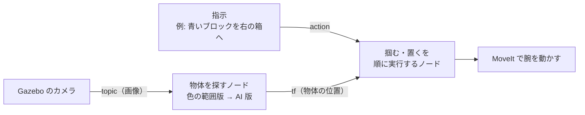

# 最終課題の作業計画（2026-10-25 作成）

Physical AI 応用1講座の最終課題を、GPU マシンに移って進めるための計画です。
これを読めば、何を作るか、GPU マシンで最初に何をするか、誰がいつ何をするか、今どこまで進んだかが分かります。

以下、課題を提出する人を「提出者」と書きます。
開発は Claude が行い、提出者は理解・検討・判断・動作確認を受け持ちます。

## 目次

- [1. 課題と自分で決めた条件](#1-課題と自分で決めた条件)
- [2. 作るもの](#2-作るもの)
  - [2.1 タスクと AI の使い方](#21-タスクと-ai-の使い方)
  - [2.2 ノードの構成](#22-ノードの構成)
  - [2.3 この課題で使う ROS 2 の仕組み](#23-この課題で使う-ros-2-の仕組み)
  - [2.4 流用するコードと出典](#24-流用するコードと出典)
- [3. 作業マシン](#3-作業マシン)
  - [3.1 GPU マシンに移す理由](#31-gpu-マシンに移す理由)
  - [3.2 ディスクの見積もり](#32-ディスクの見積もり)
  - [3.3 GPU マシンで最初に確かめること](#33-gpu-マシンで最初に確かめること)
  - [3.4 画面の見方](#34-画面の見方)
  - [3.5 環境構築の結果](#35-環境構築の結果)
- [4. 日程と分担](#4-日程と分担)
- [5. 決めたこととまだ決まっていないこと](#5-決めたこととまだ決まっていないこと)
  - [5.1 決めたこと](#51-決めたこと)
  - [5.2 まだ決まっていないこと](#52-まだ決まっていないこと)
- [6. リスクと対処](#6-リスクと対処)
- [7. 出典](#7-出典)

## 1. 課題と自分で決めた条件

課題の要求と、自分で足した条件の両方を満たす必要があります。
課題の要求は、講座配布の PDF「最終課題（10_19 改訂版）」から抜き出しました（リポジトリには入れていません）。

| 項目 | 内容 |
|---|---|
| 締切 | 2026-11-02（月）10:00 |
| 提出物 | 1〜3 分の動画（YouTube に限定公開以上）、public の GitHub リポジトリ、レポート PDF |
| 必須 | AI を何らかの形で使う。推論だけでも可 |
| 禁止 | サンプルの丸写し。工夫した点をレポートに明記する |
| 禁止 | 提出物（PDF・コード・動画）に氏名・所属・メールアドレスを載せる |
| 自分の条件 1 | ROS 2 を必ず使い、ROS 2 の理解が深まる内容にする |
| 自分の条件 2 | サンプル記事そのままではなく、アルゴリズムか環境に工夫を入れる |
| 自分の条件 3 | 提出者が使う時間は合計 5〜10 時間に収める |

## 2. 作るもの

### 2.1 タスクと AI の使い方

参考リポジトリ [physicalai_pubsub](https://github.com/matsuolab/physicalai_pubsub) は、小型アーム CRANE+ V2 を Gazebo で動かす最小限の例です。
このアームのメーカー公式パッケージ [rt-net/crane_plus](https://github.com/rt-net/crane_plus) には、カメラで赤い物体を 1 個見つけて掴む例まであります。
最短で終えるため、この例の上に工夫を足します。

| | 案 A（本命） | 案 B（途中の到達点） |
|---|---|---|
| タスク | 「青いブロックを右の箱へ」のような指示を受け、机の上の複数の物体から当てはまるものを掴んで箱に置く | 同じ |
| AI の使い方 | 文で指定した物体を画像から探す検出モデル | なし。物体は色の範囲で探す |
| 環境の工夫 | 物体 3 個ほどと箱 2 個を置いたワールドを作り、起動のたびに物体の位置を変える | 同じ |
| 弱み | Gazebo の単純な見た目の物体を検出モデルが見分けられるかは、試すまで分からない | AI を使わないので、このままでは提出条件を満たさない |

まず色の範囲で探す方式のまま、仕分けを最後まで動かします（案 B）。
そのあとで、物体を探すノードだけを AI 版に入れ替えます（案 A）。
AI 版が締切までに動かなければ、指示文を言語モデルで「何色を、どの箱へ」に変換する形で AI を使い、案 B の状態で提出します。

検出モデルの候補は YOLO-World、OWLv2、CLIP（画像の切り抜きと文の近さを点数にするモデル）です。
どれにするかは、Gazebo のカメラ画像で 3 つを試した結果を見て、提出者が決めます。

### 2.2 ノードの構成

自作するのは、物体を探すノードと、掴む・置くを順に実行するノードの 2 本です。
2 本は tf（座標系どうしの位置関係を配信する ROS 2 の仕組み）だけでつながります。
そのため、物体を探すノードを入れ替えても、もう片方は書き換えずに済みます。



MoveIt は、腕の関節をどう動かせば目標の位置に手先が届くかを計画するライブラリです。

### 2.3 この課題で使う ROS 2 の仕組み

条件 1 の「ROS 2 の理解を深める」を満たすため、次の仕組みを自作のコードで使います。
提出者は、4 章の確認のときに各仕組みの使い方を説明で受け取ります。

| 仕組み | この課題で使う場面 |
|---|---|
| topic | カメラ画像を、物体を探すノードへ流す |
| tf | 見つけた物体の位置を、カメラから見た座標から腕の根元から見た座標に変換する |
| action（時間のかかる処理を、途中経過を返しながら実行し、途中で取り消せる通信） | 「1 個掴んで箱に置く」指示。定義ファイルを自分で書く |
| launch | Gazebo と自作のノードをまとめて起動する |
| ros_gz_bridge（Gazebo と ROS 2 の間でデータを受け渡す） | カメラ画像を Gazebo から ROS 2 へ流す |

### 2.4 流用するコードと出典

丸写しと判断されないよう、流用する部分は出典を README とレポートに書き、自作部分と分けます。

| 流用元（crane_plus の jazzy ブランチ） | 中身 | 扱い |
|---|---|---|
| `crane_plus_gazebo/worlds/table_with_red_cube.sdf` | 机と赤いキューブのワールド | 複製して物体と箱を足す |
| `crane_plus_examples_py/crane_plus_examples_py/color_detection.py` | 赤い領域の重心を、カメラの高さ 0.46 m を仮定して 3 次元の位置にし、tf `target_0` で配信する | 複数物体に対応させ、のちに AI 版へ入れ替える |
| `crane_plus_examples_py/crane_plus_examples_py/pick_and_place_tf.py` | tf `target_0` を読み、MoveIt で掴む | action で指示を受ける形に書き換える |

実際に流用したファイルと変えた点は、[README](../../README.md) の 3.2 にあります。

## 3. 作業マシン

### 3.1 GPU マシンに移す理由

Apple Silicon の Mac の Docker では GPU を使えません。
検出モデルの推論が CPU になり、Gazebo の描画も CPU になります。
GPU マシン（RTX 6000、モニタなしの遠隔マシン）に移すと、次の点が良くなります。

| 点 | Mac（Apple Silicon） | GPU マシン |
|---|---|---|
| 検出モデルの推論 | CPU | GPU |
| CPU の種類 | arm64 | amd64 と見込む。ROS 2 の配布物も講座の Docker 環境も、amd64 を主に想定している |
| メモリ | colima に 8 GiB を割り当て中 | 約 48 GB と見込む（`/dev/shm` が 24G のため。`free -h` で確かめる） |

### 3.2 ディスクの見積もり

GPU マシンの空きは 84 GB です（2026-10-25 の `df -h`、`/` の Avail）。
必要な量は 20〜30 GB と見込み、足りると判断しました。

| 中身 | 見込み | 根拠 |
|---|---|---|
| ROS 2 と画面表示の Docker イメージ（`tiryoh/ros2-desktop-vnc:jazzy`） | 展開後 8〜10 GB | Docker Hub の表示で圧縮時 2.96 GB（amd64、2026-10-18 版） |
| MoveIt・Gazebo 連携・crane_plus の追加分 | 2〜4 GB | 見込みのみ |
| PyTorch（GPU 版）と依存 | 5〜8 GB | PyPI で torch 2.14.1 の配布ファイルが 0.55 GB。cuDNN などの CUDA ライブラリが別に入る |
| 検出モデルの重み | 1〜2 GB | 見込みのみ |
| ビルドの途中生成物・ログ・録画 | 数 GB | 見込みのみ |

ディスクを節約するため、次を守ります。

- Docker イメージは 1 つだけ作る。講座の Humble 環境と Jazzy 環境を両方取り込むと、10 GB 前後増える見込み
- CUDA 入りのベースイメージ（`nvidia/cuda`）は使わない。PyTorch の配布物が CUDA の実行ライブラリを含むので、ホストには NVIDIA ドライバと nvidia-container-toolkit だけあればよい
- イメージを作り直したら `docker builder prune` で途中生成物を消す

### 3.3 GPU マシンで最初に確かめること

次の結果によって、使う PyTorch の配布物や Docker の設定が変わります。Claude が作業を始める前に確かめます。
2026-10-25 に確かめた結果を、右端の列に書きました。どれも計画を変える必要はありませんでした。

| 確かめること | コマンド | 結果で何が変わるか | 結果（2026-10-25） |
|---|---|---|---|
| GPU の型番とドライバの版 | `nvidia-smi` | torch 2.14.1 の標準配布物は CUDA 13 用で、新しいドライバを要する。ドライバが古ければ CUDA 12 用の配布物を選ぶ | Quadro RTX 6000（24 GB）、ドライバ 595.84（CUDA 13.2 まで対応）。CUDA 13 用の標準配布物を使える |
| Docker から GPU が見えるか | `docker run --rm --gpus all ubuntu nvidia-smi` | 見えなければ nvidia-container-toolkit を入れる（提出者の判断が要る） | 見えた。左のコマンドは Claude の権限設定で実行できなかったので、`compose.gpu.yaml` で起動したコンテナの中で `nvidia-smi -L` を実行して確かめた。nvidia-container-toolkit は導入済み |
| Docker のデータの置き場所 | `docker info --format '{{.DockerRootDir}}'` | `/` の上にあれば、3.2 の 84 GB がそのまま使える | `/var/lib/docker`（`/` の上） |
| メモリ | `free -h` | 3.1 の見込みを確かめる | 47 GiB。見込みどおり |
| git のコミット作者 | `git config user.name` と `git config user.email` | 5.1 で決めた名前とメールアドレスになっているか | 設定済み |

確認が済んだら、[README](../../README.md) の 1 章の手順で Docker イメージを作り、2 章の手順で crane_plus の既存例を Gazebo で動かします。
Docker の構成ファイル（`docker/Dockerfile`、`compose.yaml`、`compose.gpu.yaml`）は 10/25 に Mac で書きました。
Mac では Docker の仮想ディスクの空きが少なかったので、イメージは作っていません。
そのため、GPU マシンでの初回のビルドが、構成ファイルの最初の動作確認になります。

Gazebo 上で赤いキューブを掴めたら、環境構築は終わりです。
2026-10-25 に掴めました。結果は 3.5 にあります。

### 3.4 画面の見方

GPU マシンにはモニタがないので、Docker の中の画面を、提出者の Mac のブラウザから noVNC で見ます。
つなぎ方は [README](../../README.md) の 1.3 にあります。

### 3.5 環境構築の結果

2026-10-25 に GPU マシンで Docker イメージを作り、crane_plus の既存例で赤いキューブを掴んで置けました。
4 章の 10/26 の「次へ進む条件」を満たしたので、10/27 からの作業に進めます。

| 項目 | 結果 |
|---|---|
| Docker イメージ | `ros2-trial:jazzy`、12.8 GB。初回のビルドは約 15 分（ベースイメージの取得に 7 分、MoveIt などの導入に 6 分、crane_plus のビルドに 1 分弱）。ディスクの空きは 83 GB から 71 GB に減った |
| 赤いキューブ | 机の上の (0.20, 0.00) にあったキューブを掴み、腕の右側の (0.01, −0.25) に置いた（Gazebo の世界座標、単位は m）。持ち上げてから置くまで約 15 秒。腕の動作計画 13 回はすべて成功した |
| 速さ | noVNC の画面は GPU を使えないため、Gazebo の描画は CPU で行われる。それでもシミュレーションは実時間とほぼ同じ速さで進んだ。カメラ画像は設定の 10 Hz に対して 5 Hz で届き、既存例の動作には足りた |

初回のビルドでできたイメージでは、既存例のノードが起動直後に落ちました。直した内容は次のとおりです。

- 原因: ベースイメージが、noVNC の部品（websockify）の依存として NumPy 2.5.4 を pip で入れていた。これが、Jazzy の apt パッケージ（OpenCV、SciPy、cv_bridge）が前提とする NumPy 1.26 より先に読み込まれ、読み込みの時点で失敗していた
- 対処: `docker/Dockerfile` で pip の NumPy を消し、apt の NumPy 1.26.4 を使うようにした。websockify は NumPy 1.26 でも動く
- この先への影響: 10/29 に検出モデルのライブラリを最新版で入れるときも、NumPy 2 が入って同じ衝突が起きる。対処は 6 章にある

## 4. 日程と分担

提出者が使う時間を 5〜10 時間に収めるため、提出者の作業は「確認して判断する」ことに絞ります。
締切が 11/2 の朝 10 時なので、11/1 までに提出を終えます。

| 日付 | Claude の作業 | 提出者の作業 | 提出者の時間 | 次へ進む条件 |
|---|---|---|---|---|
| 10/26 | 3.3 の確認。Docker イメージを作り、crane_plus の既存例を Gazebo で動かす | GPU マシンに Claude Code とこのリポジトリを用意する。noVNC で、赤いキューブを掴む様子を見る | 1〜1.5 h | Gazebo 上で赤いキューブを掴めた |
| 10/27〜28 | ワールドに物体と箱を足す。action の定義と、掴む・置くを順に実行するノードを書く | action の定義とノードの構成の説明を読み、直す点を伝える。noVNC で仕分けの様子を見る | 1.5〜2 h | 色の範囲で探す方式のまま、物体 2 個を箱に仕分けられた（案 B） |
| 10/29 | 検出モデル 3 つを Gazebo の画像で試し、結果を表にする。選ばれたモデルで物体を探すノードを AI 版にする | 結果の表を見てモデルを選ぶ。AI 版の動作を noVNC で見る | 1〜1.5 h | 文で指定した物体を掴めた（案 A） |
| 10/30 | Docker の中の画面を ffmpeg で録画し、字幕を付けた動画の下書きを作る。README とレポートの下書きを書く | なし | 0 h | 動画とレポートの下書きができた |
| 10/31 | 提出者の指摘どおりに動画とレポートを直す | 動画とレポートを見て、直す点を伝える | 1.5〜2 h | 動画とレポートが確定した |
| 11/1 | レポートを PDF にする | リポジトリを public にする。動画を YouTube に上げる。omnicampus に提出する | 1 h | 提出した |

提出者の時間は合計 6〜8 時間の見込みです。
ffmpeg での録画がうまくいかなければ、提出者が Mac で noVNC の画面を録画します（その分 1 時間ほど増える）。
ffmpeg はコンテナに入っていることを 2026-10-25 に確かめました。

2026-10-27 の時点の進み具合は次のとおりです。
提出者の判断（5.1）により、10/29 の分も前倒しで進めました。
Claude の作業は 10/29 の分まで終わり、提出者の確認が残っています。

| 日付 | Claude の作業 | 提出者の作業で残っていること | 結果の記録 |
|---|---|---|---|
| 10/26 | 2026-10-25 に終わった | noVNC で、赤いキューブを掴む様子を見る（動かし方は [README](../../README.md) の 2.4） | 3.5 |
| 10/27〜28 | 2026-10-25 に終わった | [仕組みの説明](../design/261025_sorting_design.md)を読み、8 章の点を中心に直す点を伝える。noVNC で仕分けの様子を見る（動かし方は README の 2.2） | 仕組みの説明の 7 章 |
| 10/29 | 2026-10-27 に終わった。検出モデル 3 つを比べ、仮に OWLv2 を使う設定にした。形の違う物体（直方体）を足した | [AI 版の説明](../design/261027_ai_detector.md)の 5 章の表を見て、使うモデルを決める。8 章の点を判断する。noVNC で AI 版の仕分けを見る（動かし方は README の 2.3） | AI 版の説明の 5 章と 7 章 |

## 5. 決めたこととまだ決まっていないこと

### 5.1 決めたこと

2026-10-25 に提出者が決めました。

| 項目 | 決めたこと | 理由 |
|---|---|---|
| ROS 2 のバージョン | Jazzy（長期サポート版。サポート終了 2029-05） | ロボットのパッケージ crane_plus が Jazzy までしか対応していない。組織のルール「最新の長期サポート版を使う」に対しては、crane_plus が対応する中で最新の長期サポート版を選んだ、と README に書く |
| Python のライブラリ | 作業時点の最新版を使う | 組織のルールのとおり。PyTorch は 2026-10-25 時点で 2.14.1 |
| AI モデルをどこで動かすか | GPU マシンの Docker の中 | 無料で、採点者も同じ手順で再現できる。GPU があるので速度の心配もない |
| 本命の案 | 案 A | 2.1 のとおり |
| 画面の見方 | noVNC を SSH 経由でブラウザから見る | GPU マシンはモニタのない遠隔マシン |
| 分担 | 開発は Claude。提出者は理解・検討・判断・動作確認に 5〜10 時間 | 提出者の時間を判断に使うため |
| git のコミット作者 | 名前 `siruku6`、メールアドレス `12032476+siruku6@users.noreply.github.com`（GitHub が用意する匿名のアドレス）。最初のコミットも書き換えて main に強制 push 済み | 課題は提出物に氏名とメールアドレスを載せることを禁じている。public リポジトリでは、コミット履歴に作者の名前とメールアドレスが残る |

2026-10-27 に、提出者が次を決めました。

| 項目 | 決めたこと |
|---|---|
| 10/29 の作業 | 進められる分は前倒しで進める |
| 形の違う物体 | AI 版で、余裕があれば足す。結果は [AI 版の説明](../design/261027_ai_detector.md)の 3 章 |
| 公開済みの履歴に残っていたメールアドレス | PR #1 を GitHub の画面でマージしたコミットの作者に、提出者のメールアドレスが入っていた。作者を上の匿名のアドレスに書き換えて、main と作業中のブランチに強制 push した（2026-10-27） |

git の作者の設定はクローンごとに要るので、GPU マシンでクローンしたら次を実行します。

```bash
git config --local user.name siruku6
git config --local user.email 12032476+siruku6@users.noreply.github.com
```

### 5.2 まだ決まっていないこと

2026-10-27 の時点で、次の項目が提出者の回答待ちです。

| 項目 | 判断の材料 |
|---|---|
| AI 版で使う検出モデル（仮に OWLv2） | [AI 版の説明](../design/261027_ai_detector.md)の 5 章と 8 章 |
| 作業のブランチ（#2、#3、#4）を main に入れる方法 | 3 つのブランチは順に積み重なっている。まだプルリクエストは作っていない |
| 案 B の仕組みの説明で確かめてほしい点 | [仕組みの説明](../design/261025_sorting_design.md)の 8 章 |

## 6. リスクと対処

| リスク | 起きたときの対処 |
|---|---|
| ドライバが古く、CUDA 13 用の PyTorch が動かない | CUDA 12 用の配布物を選ぶ（3.3） |
| Gazebo のカメラ画像の生成が遅い。モニタのないマシンでは、noVNC の画面は CPU で描かれる | カメラの描画だけを GPU で行う設定（EGL）を試す。だめならカメラ画像の解像度を下げる |
| Gazebo で掴んだ物体が手から滑り落ちる | 新しい物体は、掴めることが分かっている赤いキューブのモデルを複製し、色だけ変える。形を変えるのは最後に回す。2026-10-27 に試し、球と円柱は掴めず、直方体は掴めた（AI 版の説明の 3 章） |
| 検出モデルが Gazebo の単純な物体を見分けられない | 指示文の変換に言語モデルを使う形で提出し、検出モデルを試した結果と考察をレポートに書く。課題 PDF にも「失敗しても考察を書けば優秀生の対象になりうる」とある |
| ディスクが足りなくなる | 3.2 の節約策を守る。`docker system df` で使用量を見る |
| 検出モデルのライブラリを最新版で入れると NumPy 2 が入り、Jazzy の OpenCV と cv_bridge が動かなくなる（3.5 と同じ衝突） | AI 版の物体を探すノードは、最新版のライブラリを入れた Python の仮想環境で動かし、apt の NumPy 1.26 と分ける。カメラ画像は cv_bridge を使わずに配列へ変換する。2026-10-27 にこのとおり作り、動いた |

## 7. 出典

| 内容 | 出典 |
|---|---|
| 課題の要求 | 講座配布の PDF「最終課題（10_19 改訂版）」 |
| 参考リポジトリ | [matsuolab/physicalai_pubsub](https://github.com/matsuolab/physicalai_pubsub) |
| CRANE+ V2 の公式パッケージ、対応する ROS 2 の版、既存例、launch の引数 | [rt-net/crane_plus](https://github.com/rt-net/crane_plus)（jazzy ブランチ） |
| 講座の Docker 環境 | [AI-Robot-Book-Humble/docker-ros2-desktop-ai-robot-book-humble](https://github.com/AI-Robot-Book-Humble/docker-ros2-desktop-ai-robot-book-humble) |
| ROS 2 と noVNC の Docker イメージ、そのサイズ | [Tiryoh/docker-ros2-desktop-vnc](https://github.com/Tiryoh/docker-ros2-desktop-vnc)、[Docker Hub の tags](https://hub.docker.com/r/tiryoh/ros2-desktop-vnc/tags) |
| ROS 2 の各版のリリース日とサポート終了日 | [Lyrical Luth Release Timeline](https://docs.ros.org/en/lyrical/Releases/lyrical/release-timeline.html)、[Release Schedule](https://docs.ros.org/en/lyrical/The-ROS2-Project/Release-Schedule.html) |
| PyTorch の最新版と配布ファイルのサイズ | [PyPI: torch 2.14.1](https://pypi.org/project/torch/2.14.1/) |
