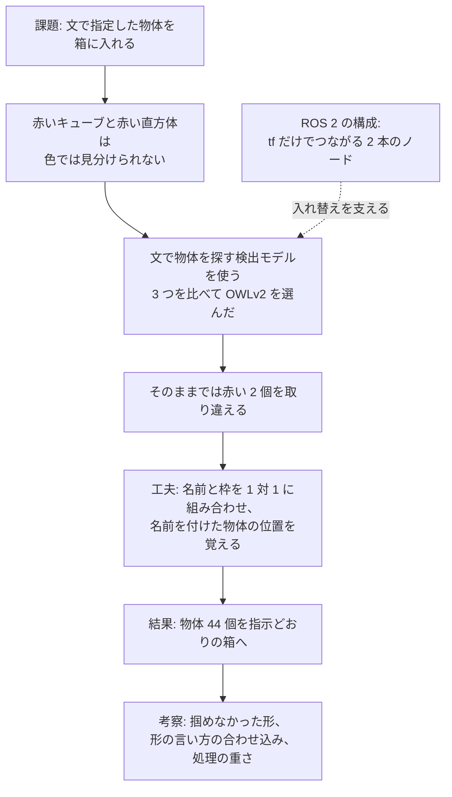

# 動画とレポートの方針（2026-10-27 作成）

提出物の動画（1〜3 分）とレポート PDF で、何を主軸に報告するかを決めるための文書です。
作ったものを全部並べると、どこが工夫なのかが伝わりにくくなります。そこで、報告の筋を 1 本決め、ほかの材料はその筋を支える位置に置きます。
提出者が 5 章の質問に答えれば、Claude が動画の撮影とレポートの下書きに進めます。

## 目次

- [1. 報告に使える材料](#1-報告に使える材料)
- [2. 報告の主軸の案](#2-報告の主軸の案)
- [3. 動画の構成案](#3-動画の構成案)
  - [3.1 場面の順番](#31-場面の順番)
  - [3.2 実演の画面](#32-実演の画面)
  - [3.3 録画の下調べ](#33-録画の下調べ)
- [4. レポートの章立て案](#4-レポートの章立て案)
- [5. 提出者に決めてほしいこと](#5-提出者に決めてほしいこと)
- [6. このあとの進め方](#6-このあとの進め方)

## 1. 報告に使える材料

主軸を選ぶ前に、見せられるものを並べます。
数字の詳しい条件は、右の列の文書にあります。

| 材料 | 中身 | 数字 | 詳しく |
|---|---|---|---|
| 仕分けのタスク | 「赤い直方体を左の箱へ」のような文の指示で、机の上の物体を左右の箱に入れる。物体の配置は起動のたびに乱数で変える | — | [計画書](261025_final_assignment_plan.md)の 2.1 |
| ROS 2 の構成 | 物体を探すノードと、掴んで箱に置くノードの 2 本が、tf（座標系どうしの位置関係を配信する仕組み）だけでつながる。指示は自分で定義した action で送る | 物体を探すノードを色で探す版から AI 版に替えても、掴む側は書き換えずに済んだ | [仕組みの説明](../design/261025_sorting_design.md)の 2・3・6 章 |
| 色で探す版（案 B） | 赤・緑・青のキューブ 3 個を、色の範囲で探して仕分ける | 10 通りの配置で 30/30 | 仕組みの説明の 7 章 |
| 検出モデル 3 つの比較 | 文で指定した物体を画像から探すモデル 3 つを、Gazebo のカメラ画像 20 枚で比べた | OWLv2 が 80/80 で最も正確 | [AI 版の説明](../design/261027_ai_detector.md)の 5 章 |
| 名前の付け方の工夫 | 名前と枠を 1 対 1 に組み合わせる。名前を付けた物体の位置を覚えておく | 赤い 2 個の見分けが 10/40 から 40/40 に上がった | AI 版の説明の 4.3・6.1 |
| AI 版の仕分け | 赤いキューブ、赤い直方体、青いキューブ、緑の直方体の 4 個を、文の指示どおりに仕分ける | 比べるのに使っていない 11 通りの配置で 44/44 | AI 版の説明の 7 章 |
| 処理を減らす工夫 | 半精度にし、推論を 1 秒に 2 回までにし、腕が動く間は止める | 仕分け中の CPU が 3.1 から 0.4 コア分に、GPU の使用率が 67% から 3% に下がった | AI 版の説明の 9 章 |
| うまくいかなかったこと | 球と円柱は掴めなかった。YOLO-World は赤い 2 個をほとんど見分けられなかった | 円柱（直径 5 cm）は 3 回とも掴めない | AI 版の説明の 3・5 章 |
| 環境の工夫 | 最新版の AI ライブラリが入れる NumPy 2 と、ROS 2 Jazzy の NumPy 1.26 がぶつかるので、AI 版のノードだけ仮想環境で動かす | — | [README](../../README.md) の 3.3 |

## 2. 報告の主軸の案

動画は 1〜3 分しかなく、レポートも採点者が短い時間で読みます。
課題 PDF は、AI を使うことと、工夫した点をレポートに明記することを求めています。
そのため、「なぜ AI が要るのか」と「どこを工夫したのか」が一度で伝わる筋を選びます。

| | 案 1: 形まで見分けて仕分ける | 案 2: 入れ替えられる ROS 2 の構成 | 案 3: 検出モデルの比較 |
|---|---|---|---|
| 一言で | 色が同じで形だけ違う物体（赤いキューブと赤い直方体）を、文の指示どおりに見分けて箱に入れる | 物体を探すノードを、色で探す版から AI 版に、掴む側を書き換えずに入れ替えた | 検出モデル 3 つを、仕分けに使えるかの観点で比べた |
| 動画の見せ場 | 赤い 2 個のうち、指示どおりの方を掴む | 同じ指示で、色で探す版と AI 版を続けて動かす | 比べた表と、検出結果の画像 |
| レポートの中心 | なぜ AI が要るか → 見分けの工夫 → 結果 | ノードの構成と、使った ROS 2 の仕組み | 比べ方と結果の表 |
| 強み | 色の範囲では見分けられないので、AI を使う理由が一目で分かる。工夫の効果を数字で示せる（10/40 → 40/40） | 自分で決めた条件 1「ROS 2 の理解が深まる内容にする」にそのまま応える | 数字が多く、考察を書きやすい |
| 弱み | ROS 2 の構成は脇役になる | AI が部品の 1 つに見え、AI を使う理由が弱い。色の違う物体なら 2 つの版は同じ動きをするので、動画では違いが見えない | ロボットが動く場面が少ない。形の言い方を同じ 20 枚で選んだので、比べた結果は合わせ込みの恐れがある |

Claude は案 1 を勧めます。理由は次のとおりです。

- 色で探す方法では見分けられない物体を、AI で見分けている。AI を使う理由が、課題の中に自然にある
- 工夫が自作の部分にある。検出モデルは公開されている重みをそのまま使っており、正しく見分けられるようにしたのは名前の付け方の工夫（1 対 1 の組み合わせと位置の記憶）
- 案 2 と案 3 の材料も、案 1 の筋の中で使える。ROS 2 の構成は「AI 版に入れ替えやすかった理由」として、モデルの比較は「OWLv2 を選んだ理由」と考察として入る

案 1 の筋は次のようになります。



## 3. 動画の構成案

採点者は、まず動画で何ができるのかを見ます。
1〜3 分に収めるため、仕分けの実演を中心にし、説明は字幕と静止画で短く入れます。
計画書 4 章のとおり、説明は字幕で入れます。
以下は案 1 の場合です。

### 3.1 場面の順番

| 時間 | 画面 | 字幕の例 |
|---|---|---|
| 0:00〜0:10 | タイトル | 文の指示で、机の上の物体を箱に仕分ける（CRANE+ V2、ROS 2 Jazzy、Gazebo、OWLv2） |
| 0:10〜0:25 | Gazebo で机の全体。物体 4 個と箱 2 個 | 赤いキューブと赤い直方体は、色が同じ。色だけでは見分けられない |
| 0:25〜0:40 | ノードの構成図（静止画） | 物体を探すノードと、掴んで置くノードは tf だけでつながる。指示は action で送る |
| 0:40〜2:10 | 4 つの指示の実演（3.2 の画面） | 送った指示と、いまの段階（探す、近づく、掴む、運ぶ、放す、戻る） |
| 2:10〜2:35 | 結果の表（静止画） | 検出モデル 3 つの比較（OWLv2 が 80/80）、仕分け 44/44、処理の削減 |
| 2:35〜2:45 | 終わり | リポジトリの URL |

4 つの指示の仕分けには、実際には約 2 分かかります（AI 版の説明の 9.3）。
腕が運んでいる間は 2〜3 倍速にし、掴む瞬間と置く瞬間は等速で見せて、1 分 30 秒ほどに縮めます。

### 3.2 実演の画面

1 つの画面に 3 つの窓を並べ、文の指示から腕の動きまでを同時に見せます。

| 位置 | 中身 | 見せたいこと |
|---|---|---|
| 左（大きく） | Gazebo。机、腕、物体、箱が全部入る角度 | 腕が、指示どおりの物体を掴んで箱に入れる |
| 右上 | 検出結果の画像。カメラ画像に、OWLv2 の枠と名前を重ねたもの | 赤い 2 個に、正しく別々の名前が付いている |
| 右下 | 指示を送る端末 | 文が「物体と箱」の組に変わり、action の途中経過が届く |

右下の端末には、たとえば次のように出ます。
段階は action の途中経過で、掴んで置くノードから届きます。

```text
[1/4] 「赤い直方体を左の箱へ」→ 物体 red_cuboid を箱 left へ
[1/4]   段階: looking
[1/4]   段階: approaching
[1/4]   段階: grasping
```

### 3.3 録画の下調べ

計画書 4 章では、録画はコンテナの中の ffmpeg で行う予定です。
撮影で困らないよう、2026-10-27 に次を確かめました。

| 確かめたこと | 結果 | 撮影までにすること |
|---|---|---|
| ffmpeg で画面を録れるか | 1920 × 1080、1 秒 30 コマで録れた | なし |
| 字幕の日本語の字体 | Noto Sans CJK JP がイメージに入っている | なし |
| 画面に個人情報が写らないか | 端末に出るのは、利用者名 `ubuntu` とコンテナの ID だけ | なし |
| 画面の保護（スクリーンセーバー） | 録画している間に画面が黒くなる | 撮影の前に止める |
| `sim.launch.py` を起動したときの画面 | RViz（ロボットの状態を表示するツール）が Gazebo の手前に開く。Gazebo の視点は腕に寄りすぎていて、机の全体が入らない | RViz を開かない。Gazebo の視点を、机の全体が入る角度にする。窓を 3.2 の配置に並べる |

録った動画は mp4 のファイルにして、提出者に渡します。
YouTube に上げるのは提出者です（計画書 4 章の 11/1）。

## 4. レポートの章立て案

課題 PDF は、工夫した点をレポートに明記することを求めています。
また、PDF には「失敗しても考察を書けば優秀生の対象になりうる」とあります（計画書 6 章）。
そのため、工夫した点を独立した章にし、うまくいかなかったことは考察の章にまとめます。
以下は案 1 の場合です。

| 章 | 書くこと | 元にする文書 |
|---|---|---|
| 1. はじめに | 何を作ったか（1 段落）。動画とリポジトリの URL | — |
| 2. タスクと環境 | 物体 4 個と箱 2 個、配置を乱数で変えること、指示の例 | 計画書の 2.1、仕組みの説明の 4 章 |
| 3. システムの構成 | ノードの図。使った ROS 2 の仕組み（topic、tf、action、launch、ros_gz_bridge） | 仕組みの説明の 2・3・6 章 |
| 4. AI の使い方 | OWLv2 で文から物体を探すこと。名前と枠の 1 対 1 の組み合わせ。位置の記憶 | AI 版の説明の 4.3・6 章 |
| 5. 工夫した点 | 環境、アルゴリズム、ROS 2 の使い方、処理の削減に分けた一覧 | 上の各章 |
| 6. 結果 | 検出モデルの比較表、仕分けの成功数、処理の削減 | AI 版の説明の 5・7・9 章 |
| 7. 考察 | 掴めなかった形（球と円柱）。形の言い方の合わせ込みの恐れ。見分けの限界（同じ名前の物体は 1 個しか置けない）。実機に移すときの課題 | AI 版の説明の 3・5 章 |
| 8. 流用したコードと出典 | crane_plus から流用したファイルと変えた点。使ったモデルとライブラリ | README の 3.1・3.2 |

レポートは Markdown でリポジトリに書きます。提出者が GitHub の画面で差分を確かめられるようにするためです。
確定したら PDF にします（計画書 4 章の 11/1）。
長さは、課題 PDF の決まり（5 章の Q2）が分かるまで、A4 で 6 ページ前後を目安にします。

## 5. 提出者に決めてほしいこと

| # | 質問 | 選択肢 | Claude の考え |
|---|---|---|---|
| Q1 | 報告の主軸 | 案 1、案 2、案 3、または組み合わせ | 案 1（2 章） |
| Q2 | 課題 PDF にある、動画とレポートの決まり | ページ数や書式、必ず書く項目、評価の観点、生成 AI の使い方についての決まり | PDF はリポジトリにないので、Claude は読めていない。該当する部分を教えてほしい。`tmp/` に PDF を置いてもらえれば読む（`tmp/` のファイルはコミットしない） |
| Q3 | 開発に Claude Code を使ったことを、レポートに書くか | 書く、書かない | 書く。public のコミット履歴には、共同作者として Claude が記録されているので、レポートと食い違わないようにする。Q2 で決まりが分かれば、それに従う |

## 6. このあとの進め方

計画書 4 章では、動画とレポートの下書きは 10/30 の作業です。
10/29 までの作業が終わったので、前倒しで進めます。

| 順 | Claude | 提出者 |
|---|---|---|
| 1 | — | 5 章の Q1〜Q3 に答える（30 分ほど） |
| 2 | 3.3 の残りを片付け、実演を撮り、字幕を付けた動画の下書きを作る | — |
| 3 | レポートの下書きを書く | — |
| 4 | 指摘どおりに直す | 動画とレポートを見て、直す点を伝える（計画書 4 章の 10/31） |
| 5 | レポートを PDF にする | 動画を YouTube に上げ、提出する（計画書 4 章の 11/1） |

2 と 3 は、それぞれ別の issue として進めます。
