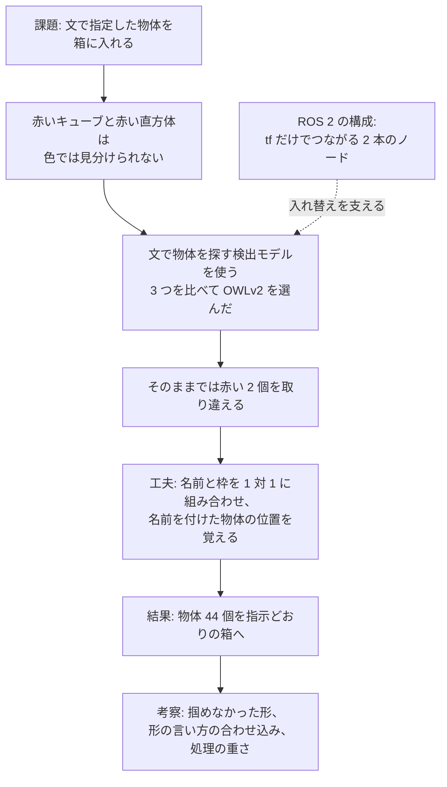

# 動画とレポートの方針（2026-10-27 作成）

提出物の動画（1〜3 分）とレポート PDF で、何を主軸に報告するかを決めるための文書です。
作ったものを全部並べると、どこが工夫なのかが伝わりにくくなります。そこで、報告の筋を 1 本決め、ほかの材料はその筋を支える位置に置きます。
2026-10-28 に提出者が決めたことは、5 章にあります。

## 目次

- [1. 報告に使える材料](#1-報告に使える材料)
- [2. 報告の主軸の案](#2-報告の主軸の案)
- [3. 動画の構成](#3-動画の構成)
  - [3.1 場面の順番と速さ](#31-場面の順番と速さ)
  - [3.2 実演の画面](#32-実演の画面)
  - [3.3 撮影でしたこと](#33-撮影でしたこと)
- [4. レポートの章立て](#4-レポートの章立て)
- [5. 決まったこと](#5-決まったこと)
- [6. このあとの進め方](#6-このあとの進め方)

## 1. 報告に使える材料

主軸を選ぶ前に、見せられるものを並べます。
数字の詳しい条件は、右の列の文書にあります。

| 材料 | 中身 | 数字 | 詳しく |
|---|---|---|---|
| 仕分けのタスク | 「赤い直方体を左の箱へ」のような文の指示で、机の上の物体を左右の箱に入れる。物体の配置は起動のたびに乱数で変える | — | [計画書](261025_final_assignment_plan.md)の 2.1 |
| ROS 2 の構成 | 物体を探すノードと、掴んで箱に置くノードの 2 本が、tf（座標系どうしの位置関係を配信する仕組み）だけでつながる。指示は自分で定義した action で送る | 物体を探すノードを色で探す版から AI 版に替えても、掴む側は書き換えずに済んだ | [仕組みの説明](../design/261025_sorting_design.md)の 2・3・6 章 |
| 色で探す版（案 B） | 赤・緑・青のキューブ 3 個を、色の範囲で探して仕分ける | 10 通りの配置で 30/30 | 仕組みの説明の 7 章 |
| 検出モデル 3 つの比較 | 文で指定した物体を画像から探すモデル 3 つを、Gazebo のカメラ画像 20 枚で比べた | OWLv2 が 80/80 で最も正確 | [AI 版の説明](../design/261027_ai_detector.md)の 5 章 |
| 名前の付け方の工夫 | 名前と枠を 1 対 1 に組み合わせる。名前を付けた物体の位置を覚えておく | 赤い 2 個の見分けが 10/40 から 40/40 に上がった | AI 版の説明の 4.3・6.1 |
| AI 版の仕分け | 赤いキューブ、赤い直方体、青いキューブ、緑の直方体の 4 個を、文の指示どおりに仕分ける | 比べるのに使っていない 11 通りの配置で 44/44 | AI 版の説明の 7 章 |
| 処理を減らす工夫 | 半精度にし、推論を 1 秒に 2 回までにし、腕が動く間は止める | 仕分け中の CPU が 3.1 から 0.4 コア分に、GPU の使用率が 67% から 3% に下がった | AI 版の説明の 9 章 |
| うまくいかなかったこと | 球と円柱は掴めなかった。YOLO-World は赤い 2 個をほとんど見分けられなかった | 円柱（直径 5 cm）は 3 回とも掴めない | AI 版の説明の 3・5 章 |
| 環境の工夫 | 最新版の AI ライブラリが入れる NumPy 2 と、ROS 2 Jazzy の NumPy 1.26 がぶつかるので、AI 版のノードだけ仮想環境で動かす | — | [README](../../README.md) の 3.3 |

## 2. 報告の主軸の案

動画は 1〜3 分しかなく、レポートも採点者が短い時間で読みます。
課題 PDF は、AI を使うことと、工夫した点をレポートに明記することを求めています。
そのため、「なぜ AI が要るのか」と「どこを工夫したのか」が一度で伝わる筋を選びます。

| | 案 1: 形まで見分けて仕分ける | 案 2: 入れ替えられる ROS 2 の構成 | 案 3: 検出モデルの比較 |
|---|---|---|---|
| 一言で | 色が同じで形だけ違う物体（赤いキューブと赤い直方体）を、文の指示どおりに見分けて箱に入れる | 物体を探すノードを、色で探す版から AI 版に、掴む側を書き換えずに入れ替えた | 検出モデル 3 つを、仕分けに使えるかの観点で比べた |
| 動画の見せ場 | 赤い 2 個のうち、指示どおりの方を掴む | 同じ指示で、色で探す版と AI 版を続けて動かす | 比べた表と、検出結果の画像 |
| レポートの中心 | なぜ AI が要るか → 見分けの工夫 → 結果 | ノードの構成と、使った ROS 2 の仕組み | 比べ方と結果の表 |
| 強み | 色の範囲では見分けられないので、AI を使う理由が一目で分かる。工夫の効果を数字で示せる（10/40 → 40/40） | 自分で決めた条件 1「ROS 2 の理解が深まる内容にする」にそのまま応える | 数字が多く、考察を書きやすい |
| 弱み | ROS 2 の構成は脇役になる | AI が部品の 1 つに見え、AI を使う理由が弱い。色の違う物体なら 2 つの版は同じ動きをするので、動画では違いが見えない | ロボットが動く場面が少ない。形の言い方を同じ 20 枚で選んだので、比べた結果は合わせ込みの恐れがある |

Claude は案 1 を勧めます。理由は次のとおりです。

- 色で探す方法では見分けられない物体を、AI で見分けている。AI を使う理由が、課題の中に自然にある
- 工夫が自作の部分にある。検出モデルは公開されている重みをそのまま使っており、正しく見分けられるようにしたのは名前の付け方の工夫（1 対 1 の組み合わせと位置の記憶）
- 案 2 と案 3 の材料も、案 1 の筋の中で使える。ROS 2 の構成は「AI 版に入れ替えやすかった理由」として、モデルの比較は「OWLv2 を選んだ理由」と考察として入る

案 1 の筋は次のようになります。



## 3. 動画の構成

採点者は、まず動画で何ができるのかを見ます。
提出者の指示（2026-10-28）で、動画には説明のスライドや長い文を入れず、ロボットの動きと、物体を認識する様子を中心に見せます。
短い時間では文を読みきれないので、説明はレポートに任せます。

### 3.1 場面の順番と速さ

| 時間 | 画面 | 字幕 |
|---|---|---|
| 0:00〜0:05 | 3.2 の画面で、指示を送る前の机 | 題名「文の指示で、色が同じで形の違う物体を見分けて仕分ける」 |
| 0:05〜1:25 | 4 つの指示の実演（3.2 の画面） | いま実行している指示。例「指示 1/4「赤い直方体を左の箱へ」」 |
| 1:25〜1:30 | リポジトリの URL | — |

動画の全体を 1.5 倍速で再生し、Gazebo の画面の右上に「1.5倍速」と出します。
課題 PDF は倍速を 2 倍まで認め、倍速にしたら明記することを求めているためです。
4 つの指示の仕分けは実際には約 2 分かかり、1.5 倍速で約 1 分 20 秒になります。
1.5 倍速にしたのは、等速では Gazebo の画面の動きが粗く（3.3）、2 倍速ではどちらの赤い物体を掴むかがすぐに過ぎてしまうからです。

画面に出す文字と速さは、すべて `tools/video/video_text.yaml` にまとめました。
このファイルを書き換えて `edit_video.py` を実行し直せば、撮り直さずに動画を作り直せます。

### 3.2 実演の画面

1 つの画面に 3 つの窓を並べ、文の指示から腕の動きまでを同時に見せます。

| 位置 | 中身 | 見せたいこと |
|---|---|---|
| 左（大きく） | Gazebo。机、腕、物体、箱が全部入る角度 | 腕が、指示どおりの物体を掴んで箱に入れる |
| 右上 | 検出結果の画像。カメラ画像に、OWLv2 の枠と名前を重ねたもの。腕が止まっているときだけ更新される（AI 版の説明の 9 章） | 赤い 2 個に、正しく別々の名前が付いている。箱に入れたあとも名前が変わらない |
| 右下 | 指示を送る端末 | 文が「物体と箱」の組に変わり、action の途中経過が届く。`video_text.yaml` の `show_terminal` で消せる |
| 左下 | 字幕 | いまの指示 |

Gazebo の視点は腕と向かい合っているので、腕から見た左右と画面の左右が逆になります。
箱の横に「右の箱」「左の箱」の札を重ねました。

右下の端末には、たとえば次のように出ます。
段階は action の途中経過で、掴んで置くノードから届きます。

```text
[1/4] 「赤い直方体を左の箱へ」→ 物体 red_cuboid を箱 left へ
[1/4]   段階: looking
[1/4]   段階: approaching
[1/4]   段階: grasping
```

### 3.3 撮影でしたこと

撮影と編集は、`tools/video/` のスクリプトで行います。
`record_demo.sh` が Gazebo と AI 版のノードを起動し、窓を並べて、4 つの指示を送りながら画面を録画します。
`edit_video.py` が、録画から 3 つの窓を切り出して並べ、字幕を付けて 1 本の MP4 にします。

撮影の前と撮影中に、次のことが分かり、対処しました。

| 分かったこと | 対処 |
|---|---|
| コンテナの中の ffmpeg で、1920 × 1080、1 秒 30 コマで画面を録れる。字幕に使う日本語の字体（Noto Sans CJK JP）もイメージに入っている | そのまま使った |
| 画面の保護（スクリーンセーバー）が働くと、録画が黒くなる | 撮影の前に止める |
| `sim.launch.py` を起動すると、RViz（ロボットの状態を表示するツール）が Gazebo の手前に開く。RViz は crane_plus の launch が必ず開く | 起動したあとに RViz を閉じる |
| Gazebo の初めの視点は腕に寄りすぎていて、机の全体が入らない | Gazebo の画面の視点を動かすサービスで、腕の正面のやや上からの視点にする（`set_gz_camera.py`） |
| 窓を動かす道具（xdotool など）はイメージに入っていない | イメージに入っている python3-xlib で窓を並べる（`arrange_windows.py`） |
| 端末（xterm）の日本語が文字化けした。UTF-8 で起動していなかった | UTF-8 で起動し、半角と全角でフォントを分ける |
| Gazebo の画面は CPU で描かれていて（llvmpipe）、腕が動いても 1 秒に約 7 回しか更新されない。3D 表示を小さくしても変わらなかった | 1.5 倍速にするので、動画では 1 秒に約 10 回動いて見える |
| 端末に出るのは、利用者名 `ubuntu` とコンテナの ID だけ。個人情報は写らない | マウスの矢印も録画に写さない |

下書きは `tmp/video/draft4.mp4`（1 分 30 秒）です（`tmp/` のファイルはコミットしない）。
録画は乱数の種 24 の配置で行い、4 個とも指示どおりの箱に入りました。
YouTube に上げるのは提出者です（計画書 4 章の 11/1）。

## 4. レポートの章立て

課題 PDF は、レポートを「課題の概要や目的、工夫した点などを記載した簡単な説明資料」としています。
加点の観点は、創造性・技術力・実用性・表現力です。
そこで、概要・目的・工夫した点を独立した章にし、実用性は目的と考察で扱います。
うまくいかなかったことは考察の章にまとめます。PDF に「失敗しても反省点や考察を書けば優秀生に選ばれうる」とあるためです。

2026-10-28 に、提出者と次の章立てで合意しました。

| 章 | 書くこと |
|---|---|
| 1. 概要 | 何を作ったか、結果（44/44）、動画とリポジトリの URL |
| 2. 目的 | なぜこのタスクか（言葉で頼む仕分けと、色だけでは見分けられない物）。自分で決めた条件 |
| 3. システムの構成 | 全体の流れ、使った ROS 2 の仕組み、流用した部分と自作の部分 |
| 4. 工夫した点 | 検出モデルの選び方、名前と枠の 1 対 1 の組み合わせ、位置の記憶、環境と指示の解釈、入れ替えられる構成、処理の削減、AI ライブラリと ROS 2 の同居 |
| 5. 結果 | 検出モデルの比較、仕分けの成功数 |
| 6. 考察 | うまくいかなかったこと、限界、実用に向けて |
| 7. 使ったものと出典 | ソフトウェアとモデル。開発での AI の活用（提出者が 1 行書く） |

レポートは、提出者の指示で、Markdown で `tmp/report/report.md` に書きます（`tmp/` のファイルはコミットしない）。
長さは A4 で 4〜5 ページを目安にします。

## 5. 決まったこと

2026-10-28 に、提出者が次のとおり決めました。

| 項目 | 決めたこと |
|---|---|
| 報告の主軸 | 案 1（色が同じで形の違う物体を、文の指示どおりに見分けて仕分ける） |
| 課題 PDF | 提出者が `tmp/references/` に置いた（コミットしない）。動画とレポートに関わる決まりは、3.1 と 4 章に反映した |
| 開発に AI を使ったことの書き方 | Claude Code の名前までは書かない。調査・方針検討・実装に AI を活用した旨を、提出者がレポートの 7.2 に 1 行書く |
| レポートの章立て | 4 章のとおり |
| 動画の文字 | 説明のスライドは入れず、文字は最小限にする。説明はレポートで読んでもらう。動画は、ロボットの動きと物体を認識する様子を中心にする |
| 動画の速さ | 全体を同じ速さにする（1 倍、1.5 倍、2 倍のどれか）。Claude が 1.5 倍を選んだ（3.1） |
| 動画の文字の置き場所 | あとで簡単に変えられるよう、1 つのファイルにまとめる（`tools/video/video_text.yaml`） |
| 動画の文字の言語 | 日本語でなくてもよい。今は日本語にしている |

## 6. このあとの進め方

計画書 4 章では、動画とレポートの下書きは 10/30 の作業です。
10/29 までの作業が終わったので、前倒しで進めます。

| 順 | Claude | 提出者 | 状態 |
|---|---|---|---|
| 1 | 報告の主軸の案を出す | 主軸などを決める（5 章） | 2026-10-28 に終わった |
| 2 | レポートの下書きを書く | — | 2026-10-28 に終わった（`tmp/report/report.md`） |
| 3 | 実演を撮り、字幕を付けた動画の下書きを作る | — | 2026-10-28 に終わった（`tmp/video/draft4.mp4`、3 章） |
| 4 | 指摘どおりに直す | 動画とレポートを見て、直す点を伝える。レポートの 7.2 に 1 行書く（計画書 4 章の 10/31） | |
| 5 | レポートを PDF にする | 動画を YouTube に上げ、提出する（計画書 4 章の 11/1） | |
