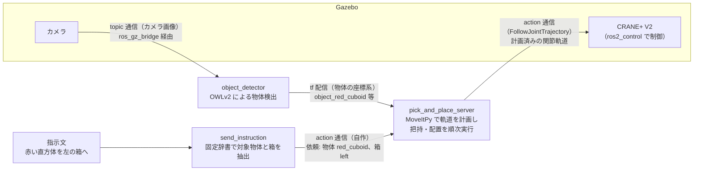

# テキスト指示に基づく同色異形物体の識別・仕分けロボットアーム

Physical AI 応用1講座 最終課題レポート

---

## 1. 概要

- 本システムは、「赤い直方体を左の箱へ」のような自然言語の入力に従い、ロボットアーム CRANE+ V2 により机上の指定された物体を把持し、指定された箱へ投入するシステムである。対象物体には、赤い立方体と赤い直方体のように、色が同一で形状のみが異なる物体（以下、同色異形物体）を含めた。
- 物体の識別には、テキストで指定した物体を画像中から検出する検出モデル OWLv2 を採用し、再学習なしで新しい物体に対してもテキストによる識別を可能にした。
- ROS 2 Jazzy および Gazebo シミュレータによる検証において、評価などに使用していない 11 通りの乱数配置で全 44 個の物体を正常に仕分けることに成功した。また、把持対象外の妨害物体（赤・青の円柱）を配置した環境でも 5 通りの配置で 20 個すべてを正しく識別・配置できた。存在しない物体や不正な指示に対しては、安全にアームを動かさず応答する動作を実現している。

*図 1: 「赤い直方体を左の箱へ」の指示を受け、赤い直方体を搬送する様子。同色の赤い立方体は机上に残存している。右下の円柱 2 個は把持対象外。*

| | |
|---|---|
| 動画 | https://youtu.be/LNO8KtAbae4 （1.5 倍速） |
| リポジトリ | https://github.com/anonymus-acc/ros2-trial （実行手順は README に記載） |

---

## 2. 目的

### 2.1 課題設定の背景

- 倉庫での仕分け作業や家庭での片付けにおいて、「その赤くて長いのを左の棚へ」のように言語で物体を指定して作業を依頼できれば、利便性が高い。しかしながら、こうした場面には、色が同一な物体が多数存在し、色に基づく物体検出（出発点とした crane_plus の既存サンプルが採用する方式）では、これらの物体を識別できない。
- 一方、テキストで指定した物体を画像中から検出するモデルであれば、色以外の情報、例えば形状を含む語句で物体を指定でき、多様なテキストと画像のペアで学習されていれば再学習なしで新規物体を識別できる。
- こうした背景から、「同色異形物体を、テキスト指示に従って識別し仕分けること」を本件における目標とした。

---

## 3. システム構成

### 3.1 処理の全体像

本システムは、指示解析 (`send_instruction`)、物体検出 (`object_detector`)、動作計画・制御 (`pick_and_place_server`) の 3 つの主要ノード群で構成される（図 2）。指示解析ノードが指示文を物体名と箱名に変換して action で依頼し、動作計画・制御ノードは、物体検出ノードが tf で配信する物体位置を取得して、接近→把持→搬送→解放→復帰の順に把持・配置を実行する。

図 2: ノード構成と通信経路。MoveIt（MoveItPy）は `pick_and_place_server` 内で関節軌道を計画するライブラリであり、通信方式ではない。計画した軌道は、MoveIt が action 通信で Gazebo 内のアーム制御器（ros2_control）へ送信し、実行させる。

図 3: `object_detector` がカメラ画像に描画した検出枠とラベル。同色の赤い立方体（`red_cube`）と赤い直方体（`red_cuboid`）に、それぞれ異なるラベルが付与されている。左上の円柱 2 個にも、円柱のラベルが付与されている（4.3 参照）

### 3.2 物体の指定方法（固定辞書と OWLv2）

指示文中の物体を画像中の物体に対応付ける処理は、以下の 2 段階で構成される。AI（OWLv2）を用いるのは後段のみである。

| 段階 | 方式 | 例 |
|---|---|---|
| ① 指示文 → 物体名・箱名 | 固定辞書との文字列照合（`send_instruction`） | 「赤い直方体を左の箱へ」→ `red_cuboid`、`left` |
| ② 物体名 → 画像中の物体 | 検出用語句を入力した OWLv2 による検出（`object_detector`） | `red_cuboid` →「red long block」に対応する検出枠 |

- **固定辞書**: 指示文中の語を物体名・箱名に変換する対応表であり、コード内にあらかじめ定義した。色、形状、箱（左・右）の語を、英語表記とあわせて登録している。
- **検出用語句**: OWLv2 に入力する英語の語句であり、物体名ごとに 1 つ設定ファイルで定義した。色を表す単語に形状を表す語句（以下、形状表現）を連結したものである（例: `red_cube` →「red square block」、`red_cuboid` →「red long block」、`red_cylinder` →「red round block」）。形状表現は、5.1 の比較で最良となったものを採用した。
- **OWLv2**: 語句で検出対象を指定でき各語句との一致度（0〜1 の得点）を出力する。再学習不要であり、指定外の物体にも似ていれば得点が付き得る。

### 3.3 自作部分と流用部分の明確化
CRANE+ V2 のメーカー公式パッケージ rt-net/crane_plus の構成をベースにしつつ、課題要件に合わせて大部分を新規開発した。

- **流用・改変**: アーム・グリッパの基本 URDF/SRDF、Gazebo/MoveIt 起動設定の一部、アームの軌道計画関数の一部。
- **自作部分**: 
  - 自作 action（定義から通信実装まで）
  - 把持・配置制御サーバノード（状態遷移、再計画、エラーハンドリング）
  - OWLv2 ゼロショット検出ノード（推論、ラベル一対一最適割り当て、3D座標復元、負荷削減制御）
  - 乱数配置および SDF 構造の動的生成スクリプト
  - 指示文に対するルールベースのパース処理および例外処理機構
  - Docker 実行環境構築

---

## 4. 工夫点

### 4.1 テキスト指定型検出モデル (OWLv2) の選定

YOLO-World、OWLv2、CLIP の 3 種を比較検証（カメラ画像 20 枚・80 物体）した。同色異形（赤い立方体と直方体）の識別において、OWLv2 に「square block」「long block」等のテキスト提示を行った場合が最も高い識別性能（80/80個正答）を示したため、OWLv2 を採用した。

### 4.2 「一対一割当」制約の導入

物体検出モデルが個別に出力する最高スコアを採用すると、同色物体のスコア差が小さいために同じラベルが複数の物体に割り当てられる問題が発生した。「机上に同一ラベルは 1 個のみ」という制約を活用し、全検出枠とラベル間のスコア総和を最大化する一対一最適割り当てを導入し、赤色異形物体の誤識別率を大幅に改善（正解数 10/40 → 40/40）した。

### 4.3 位置保持アルゴリズムと妨害物体の除外

- **位置保持**: 対象物を箱へ投入後や一時的な遮蔽（アーム通過時）でラベルが入れ替わる現象を防ぐため、最終観測位置から 2.5 cm 以内の検出枠へ同一ラベルを優先付与するトラッキングロジックを実装。
- **妨害物体（円柱）の扱い**: 搬送完了後に解放されたラベルが未登録の妨害物体（赤/青の円柱）へ転移するのを防ぐため、円柱専用のラベル（`red round block`等）も明示的に定義し、スコア分配の安定化を図った。

### 4.4 リアルタイム性と計算負荷の大幅削減

OWLv2 は計算負荷が高く、シミュレーション環境全体の遅延原因となっていた。以下の 3 施策により仕分け成功率を保ったまま GPU 使用率を 67% → 3%、CPU 使用量を 3.1 コア → 0.4 コアへ激減させた。

| 施策 | 変更前 | 変更後 |
|---|---|---|
| 半精度化 | 重みと演算を単精度（FP32）で処理。画像 1 枚 144 ms | 半精度（FP16）で処理。画像 1 枚 52 ms（識別結果は不変） |
| 推論頻度の制限 | 画像の受信ごと（毎秒 5〜8 回）に推論 | 毎秒 2 回までに制限し、超過分の画像は破棄 |
| アーム動作中の推論停止 | アームの動作中も推論 | 動作中は停止し、静止から 0.5 秒後に再開 |

アーム動作中の推論停止は、机上の物体がアームに動かされない限り移動しないことを利用したものである。

---

## 5. 結果

### 5.1 検出モデルの比較評価

物体 4 個を乱数シード 1〜20 でランダム配置した Gazebo 環境を撮影したカメラ画像 20 枚（物体 80 個）で、画像認識モデル3つの性能を比較した。モデルが出力した検出枠の中心から算出した位置が、物体の正解位置から水平方向に 2 cm 以内であれば、正しく識別したと判定した。

検出用語句の形状表現（3.2 参照）は、立方体 / 直方体の順に「cube / cuboid」「cube / rectangular block」「square block / long block」の 3 通りを試した。表には、各モデルで最良となった形状表現の結果を記載する。

| モデル | 形状表現 （立方体 / 直方体） | 正答数 (全80個) | うち赤色異形識別 正答数 (全40個) | 1枚当たり推論時間 |
|---|---|---|---|---|
| YOLO-World | cube / rectangular block | 54 | 14 | 24 ms |
| **OWLv2** | **square block / long block** | **80** | **40** | **182 ms** |
| CLIP | cube / rectangular block | 78 | 38 | 70 ms |

推論時間は、GPU（Quadro RTX 6000）・単精度での中央値である。

- 色の異なる物体は、ほぼすべてのモデルが識別した。差異が生じたのは、同色の赤色物体 2 個であった
- OWLv2 は、形状表現により結果が大きく変動した（赤色物体で 40 個中 20〜40 個）

### 5.2 仕分け試験

円柱 2 個を含むシミュレーション環境（4.4 の負荷削減策を適用したもの）で、5 通りの乱数配置に対し、下表の 6 指示を上から順に送信した。配置には、5.1 の比較と円柱の語句選定に用いた配置を除き、シード値 21 から順に 5 配置（21〜23、25、26）を採用した。箱への投入の成否は、Gazebo 上の物体の正解位置で判定した。

| 指示 | 結果（5 配置） |
|---|---|
| 赤い直方体を左の箱へ | 5/5 成功 |
| 赤い立方体を右の箱へ | 5/5 成功 |
| 青い立方体を左の箱へ | 5/5 成功 |
| 緑の直方体を右の箱へ | 5/5 成功 |
| 黄色い立方体を左の箱へ（机上に存在しない物体） | 5/5 でアームを動かさずエラー応答 |
| 赤いボールを右の箱へ（形状を表す語が固定辞書に未登録） | 5/5 でアームを動かさずエラー応答 |

通常の仕分けは計 **20/20 個（100%）成功**し、投入位置は目標箱の中心から 1.5 cm 以内であった。6 指示の処理時間は 1 配置あたり 122〜128 秒（1 物体の仕分けあたり約 30 秒）であった。

---

## 6. 考察

### 6.1 課題と暫定的な対処

- **把持できる物体の限界**: 円柱や球体は現行グリッパの摩擦・接触モデル上、上手く把持できなかったため、評価対象を面で安定保持できる形状（立方体・直方体）に絞り、円柱は環境内の「妨害物体（把持対象外）」として配置設定した。
- **動作実行拒否への対応**: 前の動作が静止する前に次の動作を計画すると、計画した軌道の始点と実際の関節角度がずれ、MoveIt が実行を拒否する現象が発生した。そこで、拒否発生時には 0.5 秒待機してアームの静止を待ち、その時点の姿勢を始点として軌道を再計画・再実行する処理を加え、拒否から回復できるようにした。

### 6.2 システムの限界と今後の展望
- **限界**: 物体位置の算出は、カメラ視線と固定高さ平面との交差によって判定しているため、積み重なった物体や高低差のある環境には対応できない。また、言語指示文解析は辞書照合のため、柔軟な口語表現に対応していない。
- **展望**: VLM（ビジョン言語モデル）による指示解析の統合、深度カメラ（3D 点群）を用いた高低差への対応、実機適用に向けたカメラキャリブレーションと多様な照明環境での評価が今後の課題である。

---

## 7. 使用技術および出典

- **ROS 2 Jazzy**: https://docs.ros.org/en/jazzy/
- **Gazebo Harmonic / MoveIt 2 (MoveItPy)**: https://gazebosim.org/ , https://moveit.ai/
- **CRANE+ V2 ROS 2 Package**: https://github.com/rt-net/crane_plus (Apache License 2.0)
- **OWLv2 Model**: `google/owlv2-base-patch16-ensemble` (Hugging Face / Apache-2.0)。論文: M. Minderer, A. Gritsenko, N. Houlsby, "Scaling Open-Vocabulary Object Detection", NeurIPS 2023
- **Docker ベースイメージ**: https://github.com/Tiryoh/docker-ros2-desktop-vnc
- **AI 活用**: 本システムのコード設計、最適化、問題デバッグおよび本レポートの構造化にあたり、大規模言語モデル (LLM) を補助的に活用した。
